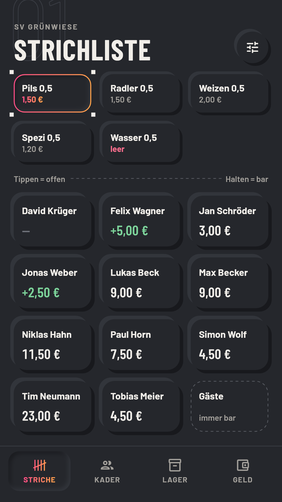
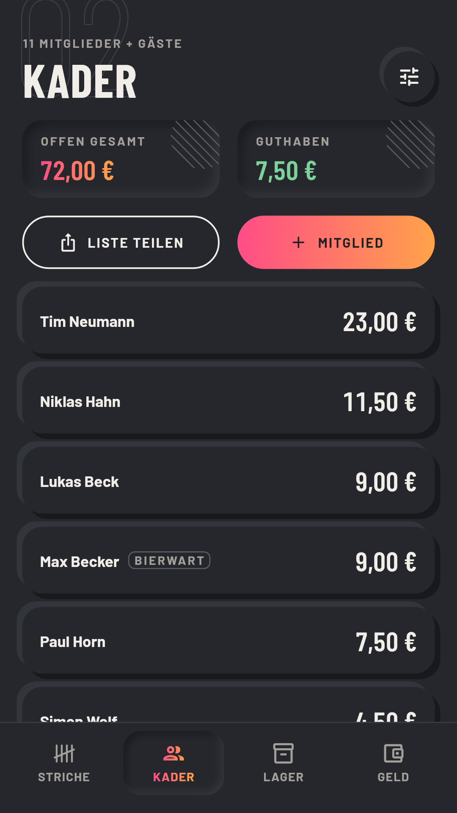
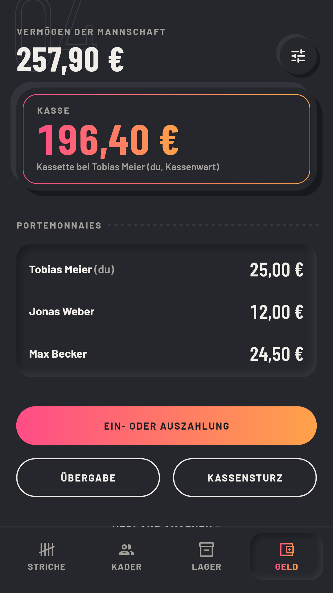
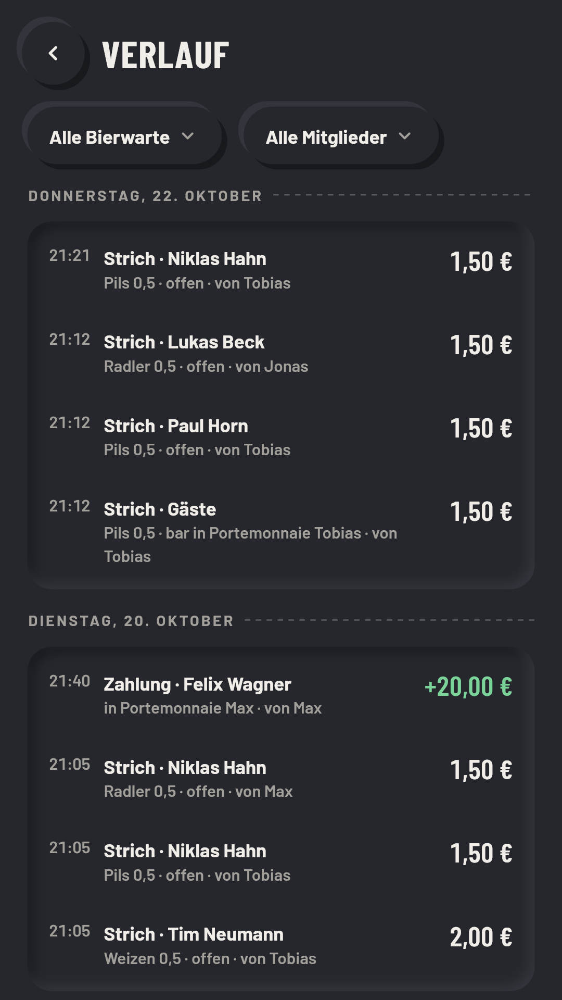
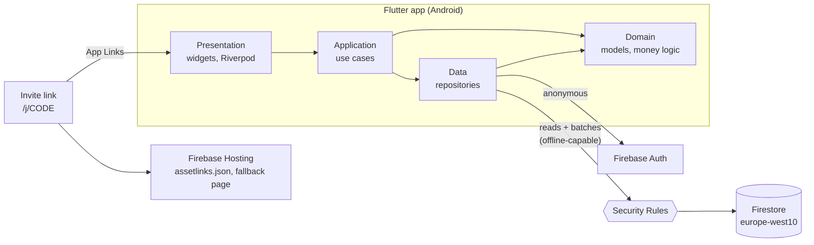

# Bierwart

[](https://github.com/Markra711/bierwart/actions/workflows/ci.yml)


**A shared tally sheet with a cash ledger for amateur sports teams.** In German locker rooms, drinks are traditionally tracked with pen-and-paper tally marks on the fridge door. Bierwart replaces that sheet: several team members ("Bierwarte") log drinks, payments and purchases together and live, and everyone can see at any time who owes what, what is in stock and where the money is.

The app is in a closed test on Google Play. This is the real development repository, with its full history. See [How this project is developed](#how-this-project-is-developed).

| Tally sheet | Squad | Money | History |
| :---: | :---: | :---: | :---: |
|  |  |  |  |

<sub>The screenshots are rendered by golden tests with a made-up team (`test/store/`).</sub>

## What it does

- **One tap, one tally mark.** Pick a drink, tap a name. A tap books the drink as unpaid, a long press books it as paid in cash. Mistakes are fixed with a counter-booking, never by deleting.
- **Squad and balances.** Every member has an open balance or credit. Partial payments are settled automatically, and the overview can be shared as text to the team chat.
- **Stock.** Drinks with price and bottle count. A purchase updates the stock and the money in one step.
- **Money always has exactly one place.** It is either in the team's cash box or in the wallet of one of the Bierwarte. Handovers, deposits, withdrawals and cash counts are bookings like everything else ([ADR-0004](docs/decisions/0004-geld-modell-kasse-portemonnaies.md)).
- **No accounts.** Anonymous sign-in, an invite link to join, and a one-time recovery code for the admin. No email, no password, no personal data besides names and amounts.
- **Works offline.** Bookings are queued on the device and synced when the network is back. Concurrent bookings from other phones are never lost.

## Technical highlights

### Security Rules as the whole backend

Release 1 runs without Cloud Functions and without a paid Firebase plan ([ADR-0009](docs/decisions/0009-release-1-ohne-cloud-functions.md)). That makes [`firestore.rules`](firestore.rules) (about 1,000 lines) the business logic:

- Every booking is **one batch**: the immutable booking document plus every total it affects (member balance, stock, wallet), updated with `FieldValue.increment()`.
- The rules check the batch **in both directions**. Each changed total must match the booking's effect exactly, and each total the booking affects must point to it (`letzteBuchungId`) in the same batch. A client can't change a balance without a matching booking, and it can't write a booking without updating the totals.
- `increment()` is applied on the server, so concurrent bookings from several phones never overwrite each other, even after an offline sync.
- Admin recovery works without a server. The client proves it knows the recovery code, and the rules compare `sha256(proof)` with the stored hash ([ADR-0010](docs/decisions/0010-wiederherstellung-mit-nachweis.md)).

I had first planned an architecture with Cloud Functions ([ADR-0007](docs/decisions/0007-aggregation-per-trigger.md)). I switched after a prototype branch with emulator tests showed that the rules-only design holds up. The tests also found its limit: a purchase can contain up to 12 drink types before Firestore's limit on document reads per request kicks in.

### A tested contract between app and rules

The app and the rules each implement the same money logic. A contract keeps them in sync:

1. Dart tests build the exact batches the app sends and write them as JSON fixtures to [`rules-tests/fixtures/`](rules-tests/fixtures/) (`FIXTURES_AKTUALISIEREN=1 flutter test`).
2. The rules tests (Vitest against the Firestore emulator) replay these fixtures. They check that the rules accept each batch and reject altered versions, such as one sent by the wrong user or one with a document missing.

If one side changes without the other, CI fails.

### Code that follows the domain

- **Money is always an `int` in cents** ([ADR-0002](docs/decisions/0002-geld-als-cent-integer.md)). Fields end in `Cents`, formatting lives in one place, and the rules check `is int`. 1,000 drinks at €1.50 add up to exactly €1,500.00.
- **Feature-first layers:** `domain/` (pure Dart, no Flutter or Firebase), `data/` (the only place that knows collection and field names), `application/`, `presentation/`.
- **Riverpod without code generation** ([ADR-0001](docs/decisions/0001-riverpod.md)). Widgets only read providers, never Firestore. Every screen handles loading and errors the same way, and every failed write is reported to the user.
- **Domain terms stay in German** (`Kasse`, `Mitglied`, `Sorte`, `Buchung`, `Portemonnaie`) as in the requirements, so code, documents and users all use the same words. Technical terms are in English.

### Design system

The app uses a custom dark neumorphic design ([ADR-0005](docs/decisions/0005-barlow-dark-neumorphism.md)), made to be read with one hand in a dim locker room. Raised surfaces can be tapped, pressed-in surfaces show a selection. Colors, spacing, shadows and type come from [`docs/design/tokens.json`](docs/design/tokens.json). The Flutter theme is derived from it, and a test fails if the two drift apart. Widgets only use tokens, never hex values or arbitrary spacing. Flutter has no inner shadows, so a custom painter draws the pressed-in surfaces.

## Architecture



| | |
| --- | --- |
| App | Flutter (Android first), Riverpod, go_router, Material with a custom theme |
| Backend | Cloud Firestore, Security Rules, anonymous Firebase Auth, App Check (Play Integrity), Firebase Hosting |
| Links | Android App Links for invites; Play Install Referrer keeps the invite code across a fresh install |
| Tests | `flutter_test` (unit, widget and golden tests), Vitest with `@firebase/rules-unit-testing` against the emulator |
| CI | GitHub Actions: format check, `flutter analyze`, `flutter test`, rules tests in the emulator |

## Tests

| Suite | Tests | What they cover |
| --- | ---: | --- |
| Dart (`test/`) | 300+ | Domain logic (money, bookings, codes), the batches the app writes, every screen as a widget test, store screenshots as golden tests |
| Security Rules (`rules-tests/`) | 260+ | Every batch from the app's fixtures, plus attacks: wrong amounts, missing totals, other people's wallets, wrong roles, expired invites |

## Documentation-driven development

The project is planned and changed through documents that live in the repository next to the code:

- [`docs/requirements.md`](docs/requirements.md): requirements with IDs (`UC-`, `STR-`, `GEL-`, `NFA-` …). Every commit that implements or changes a requirement names its IDs.
- [`docs/architecture.md`](docs/architecture.md): data model, rules, invite links, open questions.
- [`docs/decisions/`](docs/decisions/): ten Architecture Decision Records, including one that replaces an earlier decision ([ADR-0007](docs/decisions/0007-aggregation-per-trigger.md) → [ADR-0009](docs/decisions/0009-release-1-ohne-cloud-functions.md)).
- [`docs/styleguide.md`](docs/styleguide.md): components, UI texts and tone of voice.
- A **Definition of Done** in [`CLAUDE.md`](CLAUDE.md): the analyzer is clean, new logic has tests, documentation changes in the same commit, commit messages name requirement IDs, and every error is visible to the user.

The documents are in German, like the app.

## Working with AI

I built Bierwart with an AI coding agent (Claude Code). My roles were product owner, architect and reviewer. I wrote the requirements, made the decisions recorded in the ADRs, tested on real devices and reviewed every change before it was merged.

What made this work is the structure in the repository, not clever prompts:

- [`CLAUDE.md`](CLAUDE.md) gives the agent the project rules: layers, naming, money in cents, tokens only, no rules change without tests, and nothing deployed or pushed without my approval.
- Requirement IDs and ADRs make every change traceable to a decision.
- The test suites and CI are the safety net. A change is only done when they pass.

## Running it locally

You need Flutter, Node.js 22, Java 21 (for the emulators) and an Android emulator. Everything runs against the local Firebase emulators with the demo project `demo-bierwart`, so you don't need a Firebase account.

```bash
flutter pub get
flutter analyze
flutter test

# Security Rules tests in the Firestore emulator
npm --prefix rules-tests ci
npm --prefix rules-tests run test:emulator

# Run the app against the local emulators
npx --prefix rules-tests firebase emulators:start --project demo-bierwart   # UI at http://localhost:4000
flutter run --dart-define=USE_EMULATORS=true                                # in a second terminal
```

Without `USE_EMULATORS`, the app talks to the live project `bier-wart`. The Firebase client configuration in `lib/firebase_options.dart` is not a secret: it ships inside every APK, the API key is restricted to the app's package and signing keys, and the Security Rules decide what anyone may read or write. More commands, including invite links on the emulator, are in [`CLAUDE.md`](CLAUDE.md).

## Project structure

```
lib/
  main.dart                 Firebase init, ProviderScope
  src/
    app.dart                MaterialApp, theme, routing
    core/                   theme/, money/, firebase/, routing/, widgets/, links/
    features/<feature>/     domain/ data/ application/ presentation/
test/                       mirrors lib/src/
firestore.rules             Security Rules = business logic of release 1
rules-tests/                rules tests (Node, Vitest) and the fixtures written by the Dart tests
hosting/public/             assetlinks.json, invite fallback page, privacy policy, terms
docs/                       requirements, architecture, styleguide, ADRs, design tokens, store listing
tool/                       generates icons and store graphics
```

Features: `onboarding`, `strichliste` (tally sheet), `kader` (squad), `lager` (stock), `geld` (money), `einstellungen` (settings).

## How this project is developed

- One branch per topic (`feat/…`, `fix/…`, `docs/…`, `chore/…`), merged into `main` through a pull request once CI is green. `main` is never committed to directly.
- [Conventional Commits](https://www.conventionalcommits.org/) in German that name the requirement IDs they implement, for example `feat(strichliste): Strichliste mit Buchen per Tippen und Halten (STR-01 bis STR-05, …)`.
- Pull requests are merged with "Rebase and merge", so every commit on `main` stays traceable to its requirements.
- Nothing is deployed to Firebase or pushed without my explicit approval.

## License

The code is public for review as part of my portfolio. All rights reserved.

---

## Kurzfassung auf Deutsch

Bierwart ersetzt die Papier-Strichliste am Getränkekasten einer Amateurmannschaft. Mehrere Bierwarte buchen gemeinsam, live und auch offline: Striche, Zahlungen, Einkäufe und Bargeld. Jeder Euro liegt entweder in der Kasse oder im Portemonnaie eines Bierwarts.

Die App ist mit Flutter und Firebase gebaut. Release 1 kommt ohne eigenen Server aus, die Geschäftslogik steckt in den Firestore Security Rules. Jede Buchung ist ein Batch, den die Rules in beide Richtungen prüfen. Abgesichert ist das durch über 260 Emulator-Tests und einen Vertrag aus JSON-Fixtures zwischen App und Rules. Geplant und entwickelt habe ich mit Anforderungs-IDs, ADRs und einer Definition of Done, umgesetzt zusammen mit einem KI-Coding-Agenten. Die Doku im Repo ist auf Deutsch; Befehle und Arbeitsweise stehen in [CLAUDE.md](CLAUDE.md).

Die App ist im geschlossenen Test bei Google Play.
