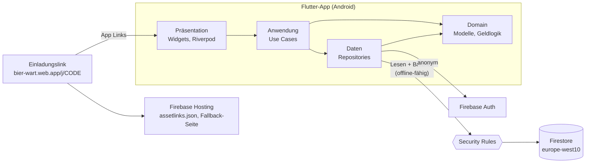
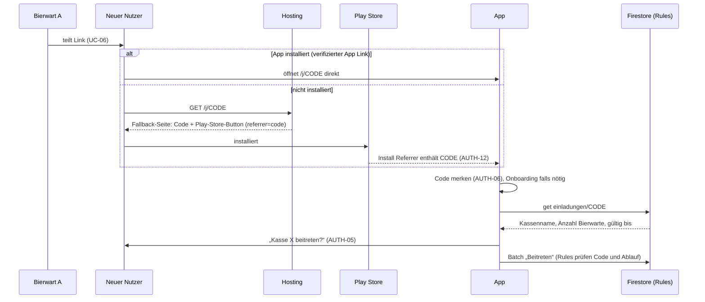

# Bierwart – Architektur (Entwurf)

- **Status:** Entwurf, Stand 2026-10-21. Punkte mit „Vorschlag“ sind noch nicht entschieden. Was offen ist, steht unter [Offene Fragen](#offene-fragen).
- **Grundlage:** [requirements.md](requirements.md), [styleguide.md](styleguide.md), [ADRs](decisions/README.md)
- **Release 1 kommt ohne Cloud Functions aus** ([ADR-0009](decisions/0009-release-1-ohne-cloud-functions.md)). Alle Rechte setzen die Security Rules durch. Cloud Functions kommen mit Release 2 (automatisches Löschen).

## Überblick



Die App schreibt alles selbst, immer als **Batch**: die eigentliche Änderung plus alle Dokumente, die davon abhängen (Summen, Log, Zähler). Die Security Rules prüfen jeden Batch als Ganzes. Was die Rules nicht erlauben, kommt nicht in die Datenbank.

| Art | Offline | Beispiele |
| --- | --- | --- |
| **Buchungen** | ja (NFA-02) | Strich, Zahlung, Einkauf, Übergabe, Ein-/Auszahlung, Storno; Kassensturz und Bestandskorrektur mit Einschränkung (siehe unten) |
| **Stammdaten** | ja | Mitglieder und Sorten anlegen, umbenennen, ausblenden, entfernen |
| **Verwaltung** | App verlangt Netz | Kasse erstellen, beitreten, Übernahme, Rollen, Link erneuern, Bierwart entfernen, austreten, auflösen, Admin wiederherstellen |

Verwaltungsaktionen würden offline technisch auch in die Warteschlange gehen. Die App lässt sie aber nur mit Netz zu, weil der Nutzer sofort wissen muss, ob es geklappt hat (NFA-10).

## Schichten in der App

Feature-first, innerhalb eines Features nach Schichten:

```
lib/
  main.dart                    Einstieg: Firebase init, ProviderScope
  firebase_options.dart        generiert (FlutterFire)
  src/
    app.dart                   MaterialApp, Theme, Routing
    core/
      theme/                   Tokens, ThemeData, ThemeExtensions
      money/                   Cent-Formatierung und -Parsing (ADR-0002)
      firebase/                Provider für Auth und Firestore; Emulator-Schalter
      routing/                 Routen und Guards (Onboarding vs. Kasse)
      widgets/                 Neumorphe Grundbausteine (Button, Card, Tile, Sheet, TabBar)
    features/
      onboarding/              Willkommen, Kasse erstellen, Code, Einladen, Beitreten, Name
      strichliste/             Tab 01
      kader/                   Tab 02, Mitglied-Detail
      lager/                   Tab 03, Einkauf, Sorte bearbeiten
      geld/                    Tab 04, Sheets, Verlauf
      einstellungen/           Einstellungen, Rollen, Austreten, Auflösen
      <feature>/
        domain/                reine Dart-Modelle und Regeln, ohne Flutter und Firebase
        data/                  Repositories, Firestore-Mapping, Batches
        application/           Notifier / Use Cases
        presentation/          Widgets, Seiten, Sheets
```

Regeln:

- **Domain** kennt weder Flutter noch Firebase. Hier liegen die Modelle (`Mitglied`, `Sorte`, `Buchung`, `Ort`) und die **Wirkung einer Buchung** auf Salden, Bestand und Ortsstände. Aus dieser Wirkung baut `data/` den Batch. Die Rules prüfen dieselbe Wirkung noch einmal, und die Rules-Tests halten beide gleich.
- **Data** kapselt Firestore. Nur hier werden Collections, Feldnamen und Batches verwendet.
- **Application** verbindet beides über Riverpod (ADR-0001).
- **Presentation** liest nur Provider, keine Firestore-Typen.
- Routing: `go_router` (`lib/src/core/routing/router.dart`), später mit Redirect je nach Zustand (nicht angemeldet → Onboarding, in Kasse → Strichliste, UI-01). Unbekannte Pfade zeigen eine Meldung statt einer leeren Seite.

## Datenmodell in Firestore

Alle Daten einer Kasse liegen unter `kassen/{kasseId}`. So bleiben die Rules einfach, und das Auflösen betrifft nur einen Teilbaum. Geld ist immer `int` in Cent (ADR-0002).

```
users/{uid}                                  welche Kasse zu diesem Nutzer gehört
kassen/{kasseId}
  bierwarte/{uid}
  uebernahmen/{anfrageId}                    „Das bin ich“-Anfragen (ADR-0008)
  mitglieder/{mitgliedId}
  namen/{nameKey}                            Eindeutigkeitsindex für Namen
  sorten/{sorteId}
  orte/{ortId}                               "kasse" oder uid eines (ehemaligen) Bierwarts
  buchungen/{buchungId}                      unveränderliches Log
einladungen/{code}                           Einladungslink → Kasse
wiederherstellung/{hashHex}                  Hash des Wiederherstellungscodes → Kasse
```

### Dokumente

| Pfad | Felder | Lesen |
| --- | --- | --- |
| `users/{uid}` | `kasseId` (Release 4: Liste, AUTH-14); gültig nur, solange der Nutzer dort Bierwart ist | nur der Nutzer selbst |
| `kassen/{k}` | `name`, `adminUid`, `kassenwartUid`, `einladungCode`, `anzahlBierwarte`, `wiederherstellungHash` (Bytes), `leerSeit` (null oder Timestamp, für AUTH-10 in Release 2), `aufgeloest` (bool), `aufloesenBestaetigung` (abgetippter Name, ADM-05), `erstelltAm`, `letzteBuchungId` | Bierwarte; nach dem Auflösen nur der Admin |
| `kassen/{k}/bierwarte/{uid}` | `mitgliedId`, `name` (denormalisiert für den Stempel), `beigetretenAm`, `einladungCode` (mit dem beigetreten wurde), `letzteBuchungId` | Bierwarte |
| `kassen/{k}/mitglieder/{id}` | `name`, `nameKey`, `istGast` (KAD-03), `bierwartUid` (oder null), `entfernt` (bool), `saldoCents` (offen; negativ = Guthaben), `letzteBuchungId`, `angelegtAm` | Bierwarte |
| `kassen/{k}/uebernahmen/{id}` | `neueUid`, `mitgliedId`, `einladungCode`, `status` (`offen`/`bestaetigt`/`abgelehnt`/`zurueckgezogen`), `angefragtAm` (gültig bis angefragtAm + 7 Tage), `entschiedenVon`, `entschiedenAm`, `letzteBuchungId` | Bierwarte und die anfragende UID |
| `kassen/{k}/namen/{nameKey}` | `mitgliedId` | jeder Angemeldete per `get` (Namensprüfung beim Beitreten, AUTH-07), Abfragen nur Bierwarte |
| `kassen/{k}/sorten/{id}` | `name`, `preisCents`, `vorherigerPreisCents` (oder null, BES-02), `aktiv` (BES-01), `bestand` (Flaschen, darf < 0, STR-05), `letzteBuchungId`, `reihenfolge` | Bierwarte |
| `kassen/{k}/orte/{ortId}` | `art` (`kasse`/`portemonnaie`), `uid`, `name`, `standCents`, `ehemalig` (GEL-08), `letzteBuchungId` | Bierwarte |
| `kassen/{k}/buchungen/{id}` | siehe unten | Bierwarte |
| `einladungen/{code}` | `kasseId`, `kassenName`, `anzahlBierwarte`, `erstelltAm` (gültig bis erstelltAm + 7 Tage), `ersetzt` (bool) | jeder Angemeldete per `get`, nie per Abfrage |
| `wiederherstellung/{hashHex}` | `kasseId`; ID ist der SHA-256 als Hex in Kleinbuchstaben | jeder Angemeldete per `get`, nie per Abfrage |

- **Ablaufzeiten:** Ein Client kann nur `serverTimestamp()` schreiben, nicht „Serverzeit + 7 Tage“. Einladungen und Übernahme-Anfragen speichern deshalb ihren Serverzeitpunkt (`erstelltAm`, `angefragtAm`). Die Rules rechnen `+ 7 Tage` selbst, die App zeigt „gültig bis“ daraus an.
- **Einladungen und Wiederherstellung:** Wer einen Code kennt, darf das zugehörige Dokument lesen. Der Code selbst ist der Nachweis. Abfragen über diese Sammlungen erlauben die Rules nicht, man kann also nicht nach Codes suchen. `kassenName` und `anzahlBierwarte` stehen in der Einladung, damit „Kasse X beitreten?“ (AUTH-05) vor dem Beitritt angezeigt werden kann. Die App pflegt beide Felder in denselben Batches wie die Kasse.
- **Namen:** `nameKey` ist der normalisierte Name (klein, Leerzeichen zusammengefasst, Unicode NFC). Das Dokument `namen/{nameKey}` sorgt dafür, dass ein Name pro Kasse nur einmal vorkommt (AUTH-07, UI-09). Ein zweites `create` auf denselben Schlüssel scheitert an den Rules.
  - Die Eindeutigkeit gilt für **alle Mitglieder** (AUTH-07, UI-09), auch für Bierwarte und „Gäste“.
  - **Entfernte Mitglieder behalten ihren Namen** (KAD-08). `namen/{nameKey}` wird beim Entfernen nicht gelöscht, damit der Verlauf eindeutig bleibt.
  - Legt jemand ein Mitglied mit einem solchen Namen an, bietet die App „Jonas Weber wieder aufnehmen?“ an. Bei Ja setzt ein Batch `entfernt = false` und schreibt die Log-Buchung `mitgliedWiederaufgenommen`. Saldo und Verlauf sind die alten, der Saldo war beim Entfernen 0 (KAD-04).
  - Beim Umbenennen wird der alte Schlüssel frei: Der Batch löscht `namen/{alt}` und legt `namen/{neu}` an.

### Buchungen (das Log)

Jede Buchung ist ein eigenes, **unveränderliches** Dokument (LOG-01, LOG-02). Die App erzeugt die ID selbst. Deshalb funktioniert das offline, und zwei gleichzeitige Buchungen überschreiben sich nie (NFA-03).

Gemeinsame Felder:

| Feld | Inhalt |
| --- | --- |
| `typ` | siehe Tabelle unten |
| `stempel` | `{ uid, name, am: serverTimestamp, geraetAm: Client-Zeit }` (Stempel). `am` ist beim Schreiben immer `request.time`, das prüfen die Rules |
| `bezugId` | bei `storno`: ID der stornierten Buchung |

| `typ` | Zusatzfelder | Wirkung | Anforderung |
| --- | --- | --- | --- |
| `strich` | `mitgliedId`, `sorteId`, `preisCents` (aktueller oder vorheriger Preis der Sorte) | Saldo + Preis, Bestand − 1 | STR-02, BES-02 |
| `strichBar` | `mitgliedId`, `sorteId`, `preisCents`, `ortId` | Bestand − 1, Ort + Preis | STR-03, KAD-03 |
| `storno` | `bezugId`, die Felder der Ursprungsbuchung; beim Bar-Strich zusätzlich `ortId` des Stornierenden | Gegenwirkung der Ursprungsbuchung; beim Bar-Strich geht der Preis aus dem Ort des Stornierenden | STR-04, STR-06 |
| `zahlung` | `mitgliedId`, `betragCents`, `ortId` | Saldo − Betrag, Ort + Betrag | GEL-02, GEL-03 |
| `einkauf` | `zeilen: {sorteId: anzahl}` (höchstens 10), `betragCents`, `ortId` | Bestand + Anzahl je Zeile, Ort − Betrag | BES-04, BES-05 |
| `bestandKorrektur` | `sorteId`, `gezaehlt`, `differenz` | Bestand = gezählt | BES-06 |
| `uebergabe` | `vonOrtId`, `nachOrtId`, `betragCents` | von − Betrag, nach + Betrag | GEL-04 |
| `einzahlung` / `auszahlung` | `ortId`, `betragCents`, `grund` | Ort ± Betrag | GEL-05 |
| `kassensturz` | `gezaehltCents`, `differenzCents` | Kasse = gezählt | GEL-06 |
| `mitgliedAngelegt`, `mitgliedUmbenannt`, `mitgliedEntfernt`, `mitgliedWiederaufgenommen`, `sorteGeaendert`, … | jeweils alt/neu | keine Geldwirkung, nur Log | LOG-01, UI-09 |
| `kasseErstellt` | `kassenName`, `startCents`, `mitgliedId`, `name` | Kasse startet mit `startCents` | UC-01, AUTH-02 |
| `bierwartBeigetreten` | `mitgliedId`, `name` | nur Log | UC-02 |
| `uebernahmeAngefragt`, `uebernahmeZurueckgezogen`, `uebernahmeAbgelehnt` | `uebernahmeId`, `mitgliedId` | nur Log | UC-03, AUTH-07 |
| `uebernahmeBestaetigt` | `uebernahmeId`, `mitgliedId`, `alteUid` (oder null), `neueUid`, `standCents` | altes Portemonnaie − Stand, neues startet mit Stand | UC-03, AUTH-07, ADR-0008 |
| `ausgetreten` | `mitgliedId` | nur Log | UC-05, AUTH-09 |
| `einladungErneuert`, `wiederherstellungscodeErneuert`, `kasseAufgeloest` | – (Codes stehen nicht im Log) | nur Log | ADM-01, ADM-08, ADM-05 |
| `bierwartEntfernt` | `uid`, `mitgliedId` | Portemonnaie wird `ehemalig` | ADM-02, GEL-08 |
| `rolleGeaendert` | `rolle` (`admin`/`kassenwart`), `vonUid`, `nachUid` | nur Log | ADM-03 |
| `kasseUmbenannt` | `nameAlt`, `nameNeu` | nur Log | ADM-04 |
| `adminWiederhergestellt` | `nachweis`; ohne Bierwart-Eintrag zusätzlich `mitgliedId`, `alteUid` (oder null), `neueUid` | altes Portemonnaie wird `ehemalig` | ADM-06, UC-03 |

„Rückgängig“ in der Snackbar (STR-04) erzeugt eine `storno`-Buchung, löscht also nichts.

**Strichliste (STR-01 bis STR-05):** Die gewählte Sorte steht lokal in `shared_preferences` je Kasse (UI-07), ohne Wahl gilt die erste. Ein Tipp baut den Batch und schreibt ihn sofort, ohne auf den Server zu warten. Lokal ist der Strich gleich sichtbar (NFA-06), offline wird er nachgereicht (NFA-02). Gebucht wird erst, wenn Kasse, UID und der eigene Name für den Stempel geladen sind. Sorten legt das Lager an, Mitglieder der Kader; ohne Sorte zeigt die Strichliste „Sorte anlegen“.

**Kader und Mitglied-Detail (KAD-01 bis KAD-08, GEL-02, GEL-03, STR-06):**
- Der Kader sortiert nach Saldo absteigend: Schulden zuerst, Guthaben zuletzt, „Gäste“ nicht (KAD-05). Die Rollen-Badges kommen aus `kassen/{k}` (Admin, Kassenwart) und `bierwarte/` (aktiv).
- Die Unterzeile „6× Bier 0,5“ aus dem Design-Canvas fehlt vorerst. Sie bräuchte die Buchungen jedes Mitglieds; die Liste zeigt nur bei Guthaben „Hat im Voraus bezahlt“.
- Das Detail zeigt Striche und Zahlungen des Mitglieds, neueste zuerst, seitenweise zu 30 Buchungen („Ältere laden“). Welche Striche nach einer Teilzahlung noch „offen“ sind, ist nicht festgelegt, deshalb gibt es keinen Abschnitt „Offene Striche“. Stornos erscheinen nicht selbst, sondern markieren ihren Strich. Ohne Serverzeit (offline gebucht) gilt `stempel.geraetAm`.
- Eine Zahlung geht ins eigene Portemonnaie, der Kassenwart kann die Kasse wählen; die Wahl sehen andere nicht (UI-08). Überzahlung wird Guthaben.
- Umbenennen nur, wenn sich der Schlüssel im Namensindex ändert. Eine reine Änderung der Groß- und Kleinschreibung lehnen die Rules ab; die App sagt das (offene Frage 26).
- Entfernen nur bei Saldo 0, nie „Gäste“ und nie aktive Bierwarte (KAD-04, KAD-02), mit Bestätigung (UI-04). Wird ein entfernter Name neu angelegt, bietet das Sheet „Wieder aufnehmen“ an (KAD-08).

**Lager (BES-01 bis BES-06):**
- Der Tab zeigt sichtbare Sorten mit Flaschenzahl und Bestandsbalken, gemessen an der Sorte mit dem größten Bestand; leere Sorten gestrichelt in `negative` (BES-03). Ausgeblendete stehen am Ende und lassen sich wieder einblenden.
- Sorte bearbeiten schreibt `sorteGeaendert`. Ändert sich der Preis, wandert der alte nach `vorherigerPreisCents`, damit offline gebuchte Striche zum alten Preis gültig bleiben (BES-02). Ohne Änderung schreibt Speichern nichts. Ausblenden fragt vorher nach (UI-04).
- Die Bestandskorrektur geht nur mit Netz (siehe Summen, Punkt 7): Die App liest den Bestand mit `Source.server`, schreibt den gezählten Wert und die Differenz und wartet auf den Server. Lehnt er ab, weil sich der Bestand inzwischen geändert hat, bittet sie, neu zu zählen.
- Der Einkauf ist eine eigene Seite mit Zeilen aus Sorte und Anzahl (+1, +6, +20, +24), höchstens 10 Sorten, doppelte Sorten werden zusammengezählt (BES-04). Bezahlt wird aus dem eigenen Portemonnaie; nur der Kassenwart sieht und wählt die Kasse (BES-05, UI-08). Er geht offline und wartet nicht.

**Geld (GEL-01, GEL-04 bis GEL-08):**
- Der Tab zeigt das Vermögen der Mannschaft im Kopf, die Kasse als Hauptkarte und darunter alle Portemonnaies: das eigene zuerst, dann alphabetisch, ehemalige zuletzt. Ein ehemaliges Portemonnaie verschwindet, sobald es auf 0 steht (GEL-08). Ein Portemonnaie im Minus steht in `negative` mit „Kasse schuldet Max 6,50 €“ (GEL-01). Namen kommen aus dem Kader, weil `orte/{uid}.name` beim Umbenennen nicht mitzieht.
- Unter der Kasse steht, wer die Kassette hat (Kassenwart) und wann zuletzt ein Kassensturz war. Das Datum liest die App aus der neuesten Buchung `kassensturz` (Index `typ` + `stempel.am`).
- **Ein- und Auszahlung** (GEL-05) darf jeder Bierwart, aus dem und in das eigene Portemonnaie. Nur der Kassenwart sieht und wählt die Kasse (UI-08). Der Grund ist Pflicht; Schnellwahl „Schiri bezahlt“, „Auslage erstattet“ (Auszahlung) und „Spende“, „Auslage zurück“ (Einzahlung), „Sonstiges“ leert das Feld zum Tippen. Geht offline und wartet nicht.
- **Übergabe** (GEL-04) sieht nur der Kassenwart: „In die Kasse“ von einem Portemonnaie, „Aus der Kasse“ in eines. Zur Wahl stehen alle sichtbaren Portemonnaies, auch das eigene und ehemalige. Der Betrag startet mit dem, was sich ausgleichen lässt: dem Stand des Portemonnaies, beziehungsweise der Auslage. Geht offline und wartet nicht.
- **Kassensturz** (GEL-06) sieht nur der Kassenwart. Er geht nur mit Netz, wie die Bestandskorrektur (siehe Summen, Punkt 7): Die App liest den Kassenstand mit `Source.server`. Weicht er von dem Stand ab, den das Sheet gezeigt hat, bucht sie nicht und bittet, die Differenz zu prüfen. So wird nie eine andere Differenz gebucht als die angezeigte. Sonst schreibt sie gezählten Betrag und Differenz und wartet auf den Server.

**Verlauf (LOG-03):**
- Eine Unterseite vom Geld-Tab aus („Verlauf ansehen“). Sie zeigt alle Buchungen der Kasse nach Tagen („Samstag, 17. Oktober“), neueste zuerst, mit Uhrzeit, Text, Stempel-Name und Betrag, seitenweise zu 50 („Ältere laden“). Ohne Serverzeit gilt `stempel.geraetAm`.
- Filter nach Bierwart (`stempel.uid`) und nach Mitglied (`mitgliedId`), auch beide zusammen; die Auswahl öffnet ein Sheet. Zur Wahl stehen alle Bierwarte, die je ein Portemonnaie hatten, und die aktuellen Mitglieder.
- Den Text baut `logZeile` in `geld/domain` aus einer `Logbuchung`, die `data/` aus dem Dokument liest. Namen löst die App über Kader (auch entfernte Mitglieder), Sorten und Orte auf; fehlt einer, steht dort „Mitglied“ oder „Sorte“, nie eine ID. Zahlungen und Einzahlungen erscheinen in `positive` mit Plus, Einkauf, Auszahlung und eine negative Kassendifferenz in `negative`, Buchungen ohne Geld mit „—“. Unbekannte Typen zeigen „Buchung“.

**Storno (STR-04, STR-06):**
- Das Mitglied-Detail zeigt alle Striche, auch bar bezahlte, mit dem Vermerk „bar“ (KAD-06).
- Strich offen stornieren: Saldo − Preis, Bestand + 1.
- **Bar-Strich stornieren:** Bestand + 1, und der Preis geht aus dem Portemonnaie **dessen, der storniert**. Er gibt das Bargeld zurück. Der Kassenwart kann stattdessen die Kasse wählen. Das passt zur Regel, dass jeder nur das eigene Portemonnaie verändert. Storniert der, der gebucht hat, gleicht es sich genau aus.
- **Nur einmal:** Die Storno-Buchung hat die feste ID `storno-{bezugId}`. Ein zweites Storno derselben Buchung wäre ein Schreibvorgang auf ein bestehendes Dokument, und den lehnen die Rules ab (Buchungen: kein `update`).
- Stornos selbst sind nicht stornierbar. Wer sich vertan hat, bucht neu.

**Rückgängig (STR-04):** Die Snackbar erscheint nur auf dem Gerät des Buchenden. Sie bleibt bis zur nächsten Buchung stehen, höchstens 8 Sekunden. Danach geht Storno nur noch über das Mitglied-Detail (STR-06), für jeden Bierwart.

**Gäste (KAD-03):** Auf „Gäste“ wird immer bar gebucht, Tippen und Halten verhalten sich gleich. Die Rules lehnen einen offenen `strich` auf ein Mitglied mit `istGast` ab.

**Kassensturz und Bestandskorrektur** sind nur mit Netz möglich. Die App zeigt beim Zählen den aktuellen Stand vom Server und sperrt die Aktion ohne Verbindung (siehe Summen, Punkt 7).

### Summen: Salden, Bestand, Ortsstände

Die Bildschirme brauchen Salden, Bestand und Ortsstände sofort, ohne jedes Mal alle Buchungen zu lesen (NFA-12, Kosten). Entschieden in [ADR-0009](decisions/0009-release-1-ohne-cloud-functions.md):

1. **Ein Batch je Buchung.** Die App schreibt die Buchung und ändert im selben Batch `mitglieder.saldoCents`, `sorten.bestand` und `orte.standCents` mit `FieldValue.increment()`. Jedes geänderte Summen-Dokument bekommt `letzteBuchungId = <id der Buchung>`.
2. **Die Rules prüfen in beide Richtungen.**
   - Eine Summe darf sich nur ändern, wenn `letzteBuchungId` auf eine Buchung zeigt, deren `stempel.am == request.time` ist, die also in genau diesem Request entsteht. Und die Änderung muss genau der Wirkung dieser Buchung entsprechen.
   - Eine Buchung darf nur entstehen, wenn alle Summen, die sie betrifft, im selben Batch auf sie verweisen.
3. **Gleichzeitigkeit:** `increment()` addiert auf dem Server. Zwei Geräte, die dasselbe Mitglied belasten, verlieren keine Buchung (NFA-03). Die Rules prüfen gegen den Stand auf dem Server, nicht gegen den Stand des Geräts.
4. **Offline:** Firestore überträgt offline geschriebene Batches beim Reconnect in Reihenfolge. Lokal sind Summe und Buchung sofort sichtbar (NFA-06), weil der Cache den Batch schon angewendet hat.
5. **Einkauf:** höchstens 10 Sorten pro Buchung. Im Emulator gingen 12, ab 13 greift das Limit der Dokumentzugriffe pro Request. Größere Einkäufe teilt die App in mehrere Buchungen.
6. **Preis (BES-02):** Erlaubt sind `preisCents` und `vorherigerPreisCents` der Sorte. Ein offline gebuchter Strich zum alten Preis scheitert so nach einer Preisänderung nicht. Erst nach einer zweiten Preisänderung würde er abgelehnt.
7. **Absolute Buchungen** (`bestandKorrektur`, `kassensturz`): Die App schreibt den gezählten Wert direkt, also ohne `increment()`, und die Differenz zum Stand, den sie sieht, in die Buchung. Die Rules prüfen `nachher == gezählt` und `nachher − vorher == differenz`. Hat ein anderes Gerät die Summe zwischendurch geändert, stimmt `vorher` nicht mehr, und der Batch wird abgelehnt. Die App meldet das und bittet, neu zu zählen (siehe offene Frage 11).

### Abfragen und Indizes

| Bildschirm | Abfrage |
| --- | --- |
| Strichliste | `sorten where aktiv == true`, `mitglieder where entfernt == false` |
| Kader | `mitglieder where entfernt == false` (Sortierung nach Saldo im Client, KAD-05) |
| Mitglied-Detail | `buchungen where mitgliedId == X orderBy stempel.am desc` (Index nötig, KAD-06) |
| Geld | `orte`, `kassen/{k}`, letzter Kassensturz: `buchungen where typ == "kassensturz" orderBy stempel.am desc limit 1` (Index nötig, GEL-06) |
| Verlauf | `buchungen orderBy stempel.am desc`, optional `where stempel.uid == X` und/oder `mitgliedId == X`, seitenweise zu 50 (Indizes nötig, LOG-03) |
| Einstellungen | `bierwarte`, `uebernahmen where status == "offen"` |

Zusammengesetzte Indizes kommen in `firestore.indexes.json`. Dort stehen die Indizes fürs Mitglied-Detail (`mitgliedId` aufsteigend, `stempel.am` absteigend) für den letzten Kassensturz (`typ` aufsteigend, `stempel.am` absteigend) und für die Filter im Verlauf (`stempel.uid`, optional `mitgliedId`, jeweils mit `stempel.am` absteigend). Der Emulator braucht sie nicht, das echte Projekt schon: Sie müssen vor dem ersten echten Einsatz deployt werden (`firebase deploy --only firestore:indexes`, nur mit Freigabe).

## Security Rules

Die Rules sind in Release 1 die Geschäftslogik. Grundsätze (NFA-07):

- Ohne Anmeldung kein Zugriff. Jeder Zugriff unter `kassen/{k}` setzt voraus, dass `kassen/{k}/bierwarte/{request.auth.uid}` existiert und die Kasse nicht `aufgeloest` ist. Eine aufgelöste Kasse liest und löscht nur noch der Admin, Buchungen entstehen dort keine mehr.
- Summenfelder (`saldoCents`, `bestand`, `standCents`) ändern sich nur zusammen mit einer passenden Buchung (siehe oben).
- Buchungen: nur `create`, nie `update`. `delete` nur beim Auflösen (LOG-02).
- Jede Verwaltungsaktion schreibt ihre Log-Buchung im selben Batch. Die Rules verlangen sie (`existsAfter`).
- `einladungen` und `wiederherstellung`: nur `get` für Angemeldete, kein `list`.

Die Rules für **alle Buchungsarten, die Stammdaten, die Mitgliedschaft und die Admin-Funktionen** liegen in `firestore.rules`. Abgedeckt sind sie mit 205 Emulator-Tests in `rules-tests/`:
- `buchungen.test.js` (47): Strich offen und bar, Storno, Zahlung, Einkauf, Bestandskorrektur, Übergabe, Ein-/Auszahlung, Kassensturz, Fälle ohne passende Buchung, Unveränderlichkeit des Logs.
- `stammdaten.test.js` (32): Mitglieder anlegen, umbenennen, entfernen, wieder aufnehmen; Namensindex; Sorten anlegen, ändern, ausblenden.
- `verwaltung.test.js` (56): Kasse erstellen, Beitreten, Übernahme anfragen, zurückziehen und entscheiden, Austreten, `users/`, Lesen von Einladungen und Namensindex.
- `admin.test.js` (43): Link erneuern, Bierwart entfernen, Rollen, Umbenennen, Wiederherstellungscode erneuern, Admin wiederherstellen mit und ohne Bierwart-Eintrag, Auflösen und Löschen.
- `vertrag.test.js` (27): Batches, wie die App sie baut: Einkauf aus Portemonnaie und Kasse, Preis ändern, Ausblenden, Bestandskorrektur samt Ablehnung bei veralteter Differenz; Kasse erstellen, danach Beitreten in diese Kasse; Sorte und Mitglied anlegen, Strich offen und bar, jeweils mit Storno, auch doppeltes Storno; Zahlung ins Portemonnaie und in die Kasse, Entfernen (erst bei Saldo 0), Wieder aufnehmen, Umbenennen mit und ohne Bierwart; Übergabe in die Kasse und zurück, Auszahlung aus der Kasse, Einzahlung ins Portemonnaie, Kassensturz samt Ablehnung bei veralteter Differenz, Übergabe nur vom Kassenwart. Die Dateien in `rules-tests/fixtures/` schreibt ein Dart-Test aus dem App-Code (`FIXTURES_AKTUALISIEREN=1 flutter test …`), und derselbe Dart-Test schlägt fehl, wenn der App-Code davon abweicht. So prüfen beide Seiten denselben Batch.

Kern des Musters:

```
function buchungDiesesRequests() {
  let b = getAfter(pfad('buchungen', request.resource.data.letzteBuchungId)).data;
  return b.stempel.am == request.time ? b : null;
}
match /mitglieder/{mitgliedId} {
  allow update: if buchungDiesesRequests() != null
    && summeGeaendert('saldoCents', saldoWirkung(buchungDiesesRequests(), mitgliedId));
}
match /buchungen/{buchungId} {
  allow create: if istBierwart()
    && stempelGueltig(request.resource.data.stempel)   // uid, Name des Bierwarts, am == request.time
    && buchungGueltig(request.resource.data, buchungId);   // je typ: Felder, Beträge int,
                                                           // Ort erlaubt, alle Summen verweisen auf diese Buchung
  allow update, delete: if false;
}
```

Zusätzlich zu den Entscheidungen oben prüfen die Rules:
- Der Name im Stempel ist der Name des buchenden Bierwarts (`bierwarte/{uid}.name`).
- Auf entfernte Mitglieder wird nicht gebucht, und auf „Gäste“ nicht offen.
- Storno geht nur für Striche (`strich`, `strichBar`). Die Felder müssen zur Ursprungsbuchung passen (siehe offene Frage 24).

**Stammdaten** folgen demselben Muster: Jede Änderung an Mitglied, Sorte oder Bierwart-Namen verweist über `letzteBuchungId` auf ihre Log-Buchung im selben Batch (LOG-01). Was die Rules dabei prüfen:
- **Mitglied anlegen** (KAD-01): Saldo 0, kein Gast, kein Bierwart, `nameKey` ist die normalisierte Form des Namens (klein, getrimmt, Leerzeichen zusammengefasst), Eintrag in `namen/` im selben Batch.
- **Umbenennen** (UI-09): Der neue Name kommt in den Index, der alte wird frei. Ist das Mitglied ein aktiver Bierwart, ändert sich `bierwarte/{uid}.name` im selben Batch mit. Nicht erlaubt für „Gäste“ und für entfernte Mitglieder.
- **Entfernen** (KAD-04): nur bei Saldo 0, nie „Gäste“, nie ein aktiver Bierwart (KAD-02). Der Name bleibt im Index (KAD-08).
- **Wieder aufnehmen** (KAD-08): `entfernt` zurück auf `false`.
- **Sorte anlegen** (BES-01): Bestand 0, Preis in ganzen Cent ≥ 0.
- **Sorte ändern oder ausblenden** (BES-01): Ändert sich der Preis, muss der alte nach `vorherigerPreisCents` wandern (BES-02). Der Bestand ändert sich nie über Stammdaten. Die Reihenfolge im Raster darf sich ohne Log-Eintrag ändern.
- **Grenze der Normalisierung:** Unicode-NFC können die Rules nicht prüfen. Die App normalisiert vorher. Schreibweisen, die sich nur in der Unicode-Form unterscheiden, könnte ein manipulierter Client also doppelt anlegen.
- **Risiko Ausdrucksgrenze:** Rules werten pro Dokument höchstens 1000 Ausdrücke aus. Der aufwendigste Fall (Umbenennen eines Bierwarts) läuft durch. Wie viel Abstand bleibt, zeigt der Emulator nicht. Wird die Kette in `buchungGueltig` länger, kann das zum Problem werden.

### Verwaltung als Batches

| Aktion | Wer | Batch | Die Rules prüfen | Anforderungen |
| --- | --- | --- | --- | --- |
| Kasse erstellen | Angemeldeter ohne Kasse | `kassen/{k}`, eigener `bierwarte`-Eintrag, eigenes Mitglied + Gäste-Mitglied (ID `gaeste`) + `namen`, Orte (Kasse mit Startbetrag, eigenes Portemonnaie 0), `einladungen/{code}`, `wiederherstellung/{hashHex}`, `users/{uid}`, Log | Ersteller ist `adminUid` und `kassenwartUid`, `anzahlBierwarte == 1`, `wiederherstellungHash` passt zur Dokument-ID unter `wiederherstellung/`, Startbetrag ist `int` | UC-01, AUTH-02, AUTH-03 |
| Einladung prüfen | Angemeldeter | – (nur `get einladungen/{code}`) | nichts zu schreiben | AUTH-05 |
| Beitreten | Angemeldeter | eigener `bierwarte`-Eintrag (mit `einladungCode`), Mitglied + `namen`, Portemonnaie, `anzahlBierwarte + 1` in Kasse und Einladung, `users/{uid}`, Log | Code ist `kassen.einladungCode`, Einladung nicht `ersetzt`, `request.time < erstelltAm + 7 Tage` (AUTH-08), Name frei, Nutzer ist in keiner anderen Kasse Bierwart | UC-02, AUTH-07, AUTH-08 |
| Übernahme anfragen | Angemeldeter | `uebernahmen/{id}` mit `einladungCode` und `angefragtAm = request.time`, Log (Stempel mit dem angefragten Namen) | gültiger Code wie beim Beitreten, `status == "offen"`, `neueUid` ist der Anfragende, der noch kein Bierwart der Kasse ist. Gilt für **jeden vergebenen Namen** außer „Gäste“: Bierwart, ehemaliger Bierwart, Mitglied ohne App, entferntes Mitglied (wird dabei wieder aktiv) | UC-03, AUTH-07, KAD-08 |
| Übernahme entscheiden | Bierwart | Status setzen; bei Bestätigung zusätzlich: `bierwarte/{neueUid}` anlegen, `bierwarte/{alteUid}` löschen, `mitglieder.bierwartUid`, Portemonnaie umziehen (`orte/{alteUid}` → `orte/{neueUid}`, gleicher Stand), Rollen in `kassen/{k}` umschreiben, Log | Anfrage war `offen` und `request.time < angefragtAm + 7 Tage`, Entscheider ist aktiver Bierwart (auch das alte Gerät), Stand und Rollen werden 1:1 übertragen; war das Mitglied kein aktiver Bierwart, `anzahlBierwarte + 1` | UC-03, AUTH-07, ADR-0008 |
| Übernahme zurückziehen | anfragende UID | `status = "zurueckgezogen"`, Log | Anfrage war `offen`, Anfragender ist `neueUid` | UC-03, AUTH-07 |
| Link erneuern | Admin | neues `einladungen/{code}`, altes `ersetzt: true`, `kassen.einladungCode`, Log | Admin | ADM-01, UC-07 |
| Bierwart entfernen | Admin | `bierwarte/{uid}` löschen, `orte/{uid}.ehemalig = true`, Link erneuern (wie oben), `anzahlBierwarte − 1`, Log | Admin; Entfernter ist nicht selbst Admin oder Kassenwart | ADM-02, UC-08, GEL-08 |
| Rolle übertragen | Admin | `kassen.kassenwartUid` oder `adminUid`, Log | Admin; Ziel ist aktiver Bierwart | ADM-03, UC-09 |
| Kasse umbenennen | Admin | `kassen.name`, `einladungen/{code}.kassenName`, Log | Admin | ADM-04 |
| Austreten | Bierwart | eigenen `bierwarte`-Eintrag und `users/{uid}` löschen, `anzahlBierwarte − 1` in Kasse und Einladung, bei 0 `leerSeit = request.time`, Log | eigenes Portemonnaie `standCents == 0`; nicht Admin oder Kassenwart (vorher übertragen), außer als letzter Bierwart | AUTH-09, UC-05, KAD-02 |
| Admin wiederherstellen | Angemeldeter | `kassen.adminUid = uid`, Kassenwart ebenso, wenn dessen UID kein aktiver Bierwart ist; neuer `wiederherstellungHash` + neues `wiederherstellung/{hashHex}`, altes löschen; Log mit Feld `nachweis` (alter Code). Ohne Bierwart-Eintrag zusätzlich: bestehendes Mitglied übernehmen oder neues anlegen, eigener `bierwarte`-Eintrag, Portemonnaie 0, altes Portemonnaie `ehemalig`, `users/{uid}`, `leerSeit = null` | `hashing.sha256(nachweis) == wiederherstellungHash`, Kasse nicht `aufgeloest`, nicht „Gäste“ | ADM-06, UC-04, UC-03 |
| Wiederherstellungscode erneuern | Admin | neuer `wiederherstellungHash`, neues `wiederherstellung/{hashHex}`, altes löschen, Log | Admin; neues Dokument passt zum neuen Hash | ADM-08 |
| Auflösen | Admin | 1. `kassen.aufgeloest = true` mit `aufloesenBestaetigung == name`; 2. alle Dokumente seitenweise löschen (auch die Buchungen); 3. Kasse, aktuelle Einladung, Wiederherstellung, `users/{uid}` löschen. Ersetzte Einladungen bleiben liegen, bis Release 2 sie aufräumt | Admin; Bestätigung entspricht dem Kassennamen (ADM-05); Löschen nur bei `aufgeloest` | ADM-05, UC-10 |

- **Wiederherstellung:** Der gesendete alte Code steht danach in der Log-Buchung (`nachweis`). Er ist aber wertlos, weil im selben Batch ein neuer Code gesetzt wird. Die App zeigt den neuen Code einmal an.
- **Wiederherstellung ohne Bierwart-Eintrag:** Wer nicht Bierwart ist, kann den Stand des alten Portemonnaies nicht lesen und deshalb nicht 1:1 übertragen wie bei einer bestätigten Übernahme. Das alte Portemonnaie wird `ehemalig` (GEL-08) und bleibt sichtbar, bis der Kassenwart es per Übergabe auf 0 bringt.
- **Format des Wiederherstellungscodes** (AUTH-03, ADM-06, ADM-08):
  - 16 Zeichen Crockford-Base32 (Ziffern und Großbuchstaben ohne I, L, O, U), also 80 Bit Zufall, angezeigt in Vierergruppen: `K7QM-3XRA-9DWF-T2HC`.
  - Die App erzeugt ihn mit `Random.secure()`.
  - Gehasht wird die normalisierte Form: Großbuchstaben, ohne Bindestriche und Leerzeichen, O → 0, I und L → 1. Die App normalisiert vor dem Senden, die Rules hashen genau diese Zeichenkette.
  - Angezeigt wird der Code nur beim Erstellen, nach einer Wiederherstellung und nach dem Erneuern, jeweils genau einmal, mit Hinweis zum Abfotografieren oder Aufschreiben.
- **Auflösen:** Bricht das Löschen ab (App geschlossen, kein Netz), bleibt die Kasse `aufgeloest`. Sie ist dann für niemanden mehr sichtbar, und die App des Admins setzt das Löschen beim nächsten Start fort.

Die Rules werden mit `@firebase/rules-unit-testing` gegen den Firestore-Emulator getestet: je Regel ein erlaubter und mindestens ein verbotener Fall. Die Tests liegen in `rules-tests/` (Node, Vitest).

**Umgesetzt** sind alle Aktionen der Tabelle. Was die Rules dabei zusätzlich festlegen:
- **Wer noch kein Bierwart ist**, darf nur die Log-Buchungen `kasseErstellt`, `bierwartBeigetreten`, `uebernahmeAngefragt` und `uebernahmeZurueckgezogen` schreiben. Der Name im Stempel ist beim Erstellen und Beitreten der neue Bierwart-Name, bei einer Anfrage der angefragte Name.
- **Übernahme:** Das alte Portemonnaie behält seine Buchungen und geht per Log-Buchung `uebernahmeBestaetigt` (Feld `standCents`) auf 0, das neue startet mit diesem Stand. Gelöscht wird es nicht, damit der Verlauf lesbar bleibt. `users/{neueUid}` schreibt das neue Gerät selbst, sobald es die Bestätigung sieht.
- **Letzter Bierwart:** Er darf mit seinen Rollen austreten, sonst könnte keine Kasse je leer werden (AUTH-10). Die Rollen zeigen danach auf eine UID ohne Bierwart-Eintrag. Die Wiederherstellung (ADM-06) holt beide Rollen zurück (offene Frage 25).
- **`hashing.sha256()`** ist im Emulator geprüft: Es rechnet über UTF-8 wie Node und Dart. `toHexString()` liefert Großbuchstaben, die Dokument-ID unter `wiederherstellung/` ist das Hex in Kleinbuchstaben, verglichen wird mit `.lower()`.

- **Admin-Funktionen** prüfen, dass der Schreibende `adminUid` ist. Ausnahme ist die Wiederherstellung, dort ist der Code der Nachweis. Bierwart entfernen erneuert immer den Link, und das Portemonnaie des Entfernten wird `ehemalig`. Admin und Kassenwart lassen sich nicht entfernen, die Rolle muss vorher übertragen werden.
- **Name und Anzahl** in der aktuellen Einladung folgen der Kasse bei jeder Änderung (AUTH-05). Die Kassen-Rule prüft das zentral.

### App Check

App Check sorgt dafür, dass Firestore nur Anfragen der echten App annimmt, nicht von eigenen Programmen mit dem öffentlichen API-Key. Gegen einen Bierwart, der die echte App benutzt, hilft es nicht, dafür sind die Rules da. Ohne Server-Code ist es der einzige Schutz gegen fremde Clients (NFA-07).

- **Release 1 baut App Check ein:** Paket `firebase_app_check`, im Release-Build mit dem Provider Play Integrity, beim Entwickeln mit dem Debug-Provider. Gegen die Emulatoren braucht es kein App Check.
- **Erzwungen wird erst zum Store-Release:** Play Integrity setzt voraus, dass die App in der Play Console angelegt und mit dem Firebase-Projekt verknüpft ist. Vorher würde ein Erzwingen alle Builds außer Debug-Builds mit eingetragenen Debug-Tokens aussperren. Die Schritte stehen unter [Vor dem Store-Release](#vor-dem-store-release).

## Cloud Functions (ab Release 2)

Release 1 hat keine Cloud Functions ([ADR-0009](decisions/0009-release-1-ohne-cloud-functions.md)). Mit Release 2 kommt die erste:

| Function | Auslöser | Tut | Anforderung |
| --- | --- | --- | --- |
| `aufraeumen` | täglich (Cloud Scheduler) | Löscht Kassen mit `leerSeit` älter als 30 Tage, Kassen ohne Buchung seit 12 Monaten und abgelaufene Einladungen, jeweils rekursiv mit dem Admin SDK | AUTH-10, AUTH-11 |

Festgelegt für dann:
- Region **`europe-west10`**, wie die Firestore-Datenbank. Gesetzt im Code über `setGlobalOptions({ region: "europe-west10" })`. Daten und Verarbeitung liegen damit in Deutschland (NFA-09).
- Blaze-Tarif mit Budget-Alarm (siehe [Vor dem ersten Functions-Deploy](#vor-dem-ersten-functions-deploy)).

„Keine Buchung seit 12 Monaten“ liest die Function aus der neuesten Buchung jeder Kasse. Release 1 muss dafür kein eigenes Feld pflegen.

## Einladungslinks: Hosting + App Links

Format: `https://bier-wart.web.app/j/{code}`. `code` sind 20 Zeichen Crockford-Base32 (100 Bit), erzeugt mit `Random.secure()`. Ohne Server-Code gibt es keine Bremse gegen Durchprobieren, also muss der Code selbst sicher genug sein (mindestens 96 Bit). Angezeigt wird er in Vierergruppen (`K7Q2-MXA9-3DWF-T2HC-8RNP`), meist wird aber der Link geteilt. Eingefügte Links oder Codes normalisiert die App wie den Wiederherstellungscode. Der Link ist 7 Tage gültig. Geprüft wird in den Rules beim Beitreten (AUTH-08).



Bausteine:

- **Hosting** (`hosting/public/`):
  - `/.well-known/assetlinks.json` mit Paketname (`io.github.markra711.bierwart`) und SHA-256-Fingerabdrücken. Header `Content-Type: application/json`.

    | Schlüssel | SHA-256 | Stand |
    | --- | --- | --- |
    | Debug (`~/.android/debug.keystore` auf Marvins Rechner) | `99:AC:29:B1:25:49:3C:32:40:8A:D0:82:41:0F:A2:93:C8:71:E8:48:61:D2:32:00:00:AE:EB:5B:E8:F9:19:29` | aktiv, für Tests auf eigenen Geräten |
    | Upload-Key | – | kommt mit dem Store-Release |
    | Play App Signing | – | kommt mit dem Store-Release |

    Jeder Rechner hat einen eigenen Debug-Key. Wer auf einem anderen Rechner baut, muss dessen Fingerabdruck ergänzen, sonst öffnen sich Links dort im Browser statt in der App.
  - `firebase.json`-Rewrite `/j/**` → `/j.html`: eine statische Seite, die den Code aus der URL zeigt, einen Play-Store-Link mit `&referrer=code%3D{code}` anbietet und den Code zum Kopieren bereitstellt (für „Link einfügen“). Sie prüft den Code nach denselben Regeln wie die App (`codes.dart`) und meldet unvollständige Links. Ein Header liefert `assetlinks.json` als `application/json`.
- **Android**: `intent-filter` mit `android:autoVerify="true"` für `https://bier-wart.web.app/j/*` in `AndroidManifest.xml`. Flutters eigenes Deep Linking ist dort ausgeschaltet (`flutter_deeplinking_enabled = false`); sonst bekäme auch `go_router` den Pfad `/j/…`. Verifiziert ist der Link erst, wenn `assetlinks.json` auf `bier-wart.web.app` liegt, also nach dem ersten Hosting-Deploy. Bis dahin öffnet Android den Link im Browser, außer man startet ihn gezielt für die App (siehe `CLAUDE.md`).
- **App**: Paket `app_links` empfängt eingehende Links. Paket für den Play Install Referrer (z. B. `play_install_referrer`) liest den Code nach der Erstinstallation (AUTH-12). Ein offener Code wird in `shared_preferences` gemerkt, bis die Namenswahl fertig ist (AUTH-06). Umgesetzt im `OffenerCodeNotifier` (`onboarding/application`): Ohne Kasse führt die Weiterleitung mit offenem Code vom Start direkt zu „Kasse beitreten?“, ein Link bei offener App springt sofort dorthin. Verworfen wird der Code nach dem Beitritt, bei „Nein“, bei „Anderer Link“ und wenn der Nutzer schon in einer Kasse ist. Den Referrer liest die App nur beim ersten Start.
- **iOS** (Release 3, AUTH-13): Universal Links über `apple-app-site-association` auf derselben Domain.

## Offline, Gleichzeitigkeit, Fehler

- Firestore-Offline-Persistenz ist auf Android standardmäßig an. Buchungen und Stammdaten werden lokal geschrieben und später synchronisiert (NFA-02).
- Jede Buchung ist ein neues Dokument mit Client-ID. Summen ändern sich nur per `increment()`. Damit gibt es keine verlorenen Updates (NFA-03). Ausnahme sind die absoluten Buchungen (siehe Summen, Punkt 7).
- Lehnen die Rules eine Offline-Schreibung beim Sync ab (z. B. Name inzwischen vergeben, Stand beim Kassensturz geändert), nimmt Firestore den lokalen Batch zurück, und die App meldet das sichtbar (NFA-10). Dafür müssen die Write-Futures beobachtet werden, auch nach dem Verlassen des Bildschirms (globaler Fehlerkanal, Snackbar).
  - Umgesetzt im `FehlerkanalNotifier` (`lib/src/core/fehler/`): Buchungen und Stammdaten warten nicht auf den Server, ihr Schreib-Future beobachtet der Kanal. Schlägt es fehl, zeigt die App eine Snackbar, egal auf welchem Bildschirm.
- **Batches als Daten:** Jeder Batch entsteht im App-Code als Liste von `Schreibvorgang` (`lib/src/core/firebase/schreibvorgang.dart`), geschrieben über `Schreiber` (Firestore: `BatchSchreiber`). Das macht ihn als Fixture für die Rules prüfbar und in Widget-Tests mit einer Fake-Datenbank anwendbar.
- Verwaltungsaktionen prüft die App vorab auf Netz: eine Abfrage direkt beim Server (`Source.server`). Ohne Netz zeigt sie sofort „Dafür brauchst du Netz“, statt endlos zu warten. Antwortet der Server nicht binnen 20 Sekunden, meldet sie das ebenfalls.
- **Kasse erstellen:** Codes und IDs stehen fest, bevor geschrieben wird. Die Weiterleitung hält den Nutzer im Ablauf, bis der Server den Batch angenommen und die App Wiederherstellungscode und Einladung gezeigt hat (AUTH-03). Lehnt der Server ab, bleibt er im Formular und sieht die Meldung (NFA-10).
- **Beitreten:** Link einfügen → „Kasse beitreten?“ → „Wie heißt du?“. Der Code steht als `?code=` in der Route, damit Einladungslinks später direkt einsteigen. Die App lädt die Einladung direkt vom Server und zeigt abgelaufene, ersetzte und unbekannte Links mit eigener Meldung (AUTH-08); maßgeblich bleiben die Rules. Vor dem Batch prüft sie `namen/{nameKey}`. Ist der Name vergeben, zeigt sie das und lässt einen anderen wählen. „Das bin ich“ (UC-03) fehlt noch, bis Warte- und Anfrage-Screen im Design-Canvas stehen (offene Frage 23). Während der Batch läuft, hält die Weiterleitung den Nutzer auf der Namenswahl.

## Lokale Entwicklung und Tests

- Emulatoren: Auth, Firestore und Hosting (Fallback-Seite unter http://localhost:5000/j/{code}). Lokal mit Demo-Projekt `demo-bierwart`, damit nie echte Daten berührt werden.
- Die App verbindet sich mit den Emulatoren, wenn sie mit `--dart-define=USE_EMULATORS=true` gestartet wird; in Release-Builds ist der Schalter immer aus. Sie nutzt dann eine eigene Firebase-App mit `demoProjectId: demo-bierwart`, damit nie echte Daten berührt werden. Eine eigene App ist nötig, weil das native Android-SDK aus `google-services.json` schon die Standard-App für `bier-wart` anlegt und FlutterFire abweichende Optionen dafür still ignoriert. Deshalb holen alle Dienste ihre Instanz über `firebaseAppProvider` (`instanceFor(app: …)`), nie über `.instance`. Host ist `10.0.2.2` (Android-Emulator), für ein echtes Gerät `--dart-define=EMULATOR_HOST=<IP des Rechners>`. Das Debug-Manifest erlaubt dafür unverschlüsseltes HTTP (`lib/src/core/firebase/emulatoren.dart`).
- Tests:
  - Dart: Unit-Tests für Domain (Geld, Buchungswirkung, Batch-Aufbau), Widget-Tests für Bildschirme.
  - Rules: `rules-tests/` mit `@firebase/rules-unit-testing` gegen den Emulator (NFA-07): `npm --prefix rules-tests run test:emulator`. Die Firebase CLI ist dort als feste Version eingetragen, damit lokal und in der CI dasselbe läuft.
- CI (GitHub Actions): Job „Analyze und Tests“ (`flutter analyze`, `flutter test`) und Job „Security Rules (Emulator)“ (Node 22, Java 21, Rules-Tests).

## Vor dem ersten Deploy

Bis dahin läuft alles lokal gegen die Emulatoren. Release 1 braucht nur den Spark-Tarif.

- [ ] Security Rules mit vollständigen Emulator-Tests fertig, bevor irgendetwas deployt wird (NFA-07).
- [ ] Limit der Dokumentzugriffe beim Einkauf gegen das echte Projekt prüfen (Emulator: 12 Sorten). Dafür braucht es einen Rules-Deploy, also deine Freigabe.
- [ ] Deploy nur mit ausdrücklicher Freigabe (siehe `CLAUDE.md`).

## Vor dem ersten Functions-Deploy

Erst mit Release 2 (AUTH-10, AUTH-11).

- [ ] Projekt `bier-wart` auf den Blaze-Tarif umstellen (Konsole, macht Marvin). Nötig für Cloud Functions und Cloud Scheduler.
- [ ] Budget-Alarm von 1 € im Monat einrichten (NFA-12). Der Alarm warnt nur, er begrenzt die Kosten nicht.
- [ ] Beim ersten Deploy prüfen, dass die Functions in `europe-west10` angelegt werden. Der Emulator prüft Regionen nicht.

## Vor dem Store-Release

Aufgaben, die erst mit dem Play-Store-Eintrag anfallen. Keine davon blockiert die Entwicklung.

- [ ] Entwicklerkonto in der Play Console und App `io.github.markra711.bierwart` anlegen (Konsole, macht Marvin).
- [ ] Upload-Key erzeugen, sicher verwahren (nicht im Repo), Signierung in `android/app/build.gradle.kts` über `key.properties` einrichten.
- [ ] SHA-256 von Upload-Key und Play App Signing in `assetlinks.json` eintragen (AUTH-04).
- [ ] SHA-1 des Release-Keys in der Firebase-Konsole bei der Android-App hinterlegen.
- [ ] Android-API-Key in der Google Cloud Console auf Paketname und SHA-1 (Debug + Release) einschränken. Der Key steht öffentlich in der APK; die Einschränkung verhindert, dass fremde Apps ihn benutzen.
- [ ] App Links mit dem Release-Build auf einem echten Gerät prüfen (`adb shell pm get-app-links io.github.markra711.bierwart`).
- [ ] App Check: In der Play Console unter „App-Integrität“ die Play Integrity API mit dem Firebase-Projekt verknüpfen. In der Firebase-Konsole unter App Check die Android-App mit dem SHA-256 des Play-App-Signing-Schlüssels für Play Integrity registrieren (beides Konsole, macht Marvin).
- [ ] App-Check-Statistik in der Firebase-Konsole prüfen: Haben praktisch alle Firestore-Anfragen ein gültiges Token? Erst dann **Erzwingen für Firestore** einschalten (Konsole, macht Marvin, nur mit Freigabe).

## Kosten (grobe Schätzung, NFA-12)

Annahme: eine Mannschaft, 5 Bierwarte, 30 Mitglieder, ca. 5.000 Buchungen pro Jahr.

- Schreiben: ca. 15 Buchungen am Tag, je Batch 3–4 Dokumente (Buchung + Summen). Weit unter dem Gratiskontingent.
- Lesen: Listener auf Mitglieder, Sorten und Orte. Verlauf und Mitglied-Detail seitenweise. Die `get()`-Aufrufe der Rules zählen als Lesevorgänge, das sind einige pro Batch. Bleibt bei Nutzung von Offline-Cache und kurzen Wiederverbindungen voraussichtlich im Gratiskontingent.
- Hosting: im Gratisrahmen. Release 1 hat keine Functions.

Diese Schätzung ist zu prüfen, sobald es echte Nutzung gibt.

## Offene Fragen

Ich habe sie nicht entschieden. Jede braucht eine Antwort, bevor der jeweilige Teil gebaut wird.

1. ~~**Aggregation**~~ – entschieden: erst per Trigger (ADR-0007), ersetzt durch Batches mit Rules-Prüfung ([ADR-0009](decisions/0009-release-1-ohne-cloud-functions.md)).
2. ~~**„Das bin ich (neues Gerät)“ absichern**~~ – entschieden: Bestätigung durch einen anderen aktiven Bierwart ([ADR-0008](decisions/0008-uebernahme-bestaetigung.md)). Daraus folgen die Fragen 21 bis 23.
3. ~~**Paketname / applicationId**~~ – entschieden: `io.github.markra711.bierwart` ([ADR-0006](decisions/0006-paketname.md)).
4. ~~**SHA-256-Fingerabdrücke**~~ – entschieden: zunächst nur der Debug-Key (siehe [Einladungslinks](#einladungslinks-hosting--app-links)); Upload-Key und Play App Signing stehen unter [Vor dem Store-Release](#vor-dem-store-release).
5. ~~**Blaze-Tarif**~~ – entschieden: Release 1 im Spark-Tarif; Blaze mit Budget-Alarm erst mit Release 2 (siehe [Vor dem ersten Functions-Deploy](#vor-dem-ersten-functions-deploy)).
6. ~~**Functions-Region**~~ – entschieden: `europe-west10`, gilt ab Release 2 (siehe [Cloud Functions](#cloud-functions-ab-release-2)).
7. **Sprache der Functions:** vertagt auf Release 2. Stand Oktober 2026: TypeScript ist ausgereift; Dart ist experimentell, Firestore-Trigger sind dort nicht deploybar. Für den reinen Scheduler-Job von Release 2 ist neu zu prüfen.
8. ~~**Storno eines Bar-Strichs**~~ – entschieden: wer storniert, zahlt aus dem eigenen Portemonnaie zurück (Kassenwart wahlweise Kasse); jede Buchung nur einmal stornierbar (siehe [Buchungen](#buchungen-das-log)).
9. ~~**„Rückgängig“**~~ – entschieden: Snackbar nur beim Buchenden, bis zur nächsten Buchung, höchstens 8 Sekunden; danach Storno im Mitglied-Detail (siehe [Buchungen](#buchungen-das-log)).
10. ~~**Gäste-Buchungen**~~ – entschieden: immer bar, Tippen wie Halten; KAD-03 angepasst.
11. ~~**Kassensturz und Bestandskorrektur offline**~~ – entschieden: nur mit Netz.
12. ~~**Wiederherstellungscode**~~ – entschieden: 16 Zeichen Crockford-Base32 (80 Bit) in Vierergruppen; der Admin kann einen neuen Code erzeugen (ADM-08, siehe [Verwaltung als Batches](#verwaltung-als-batches)).
13. ~~**App Check**~~ – entschieden: in Release 1 eingebaut, erzwungen erst zum Store-Release (siehe [App Check](#app-check)).
14. **Verwaiste anonyme Nutzer** in Firebase Auth (z. B. nach Neuinstallation): aufräumen, und wenn ja, nach welcher Frist? (Ohne Functions frühestens Release 2.)
15. ~~**Schriften offline**~~ – entschieden: Barlow und Barlow Condensed liegen als Assets in der App, `google_fonts` entfällt (siehe `docs/styleguide.md`, Typografie).
16. ~~**Innere Schatten**~~ – entschieden: eigener Painter (`InnenschattenPainter`, `BwEingedrueckt` in `lib/src/core/widgets/flaechen.dart`), direkt aus den `inset`-Tokens.
17. ~~**Routing**~~ – entschieden: `go_router`.
18. **Datenschutzhinweis (NFA-09):** Wer liefert den Text, und reicht ein Bildschirm in den Einstellungen? Er muss erwähnen, dass verlassene Kassen in Release 1 nicht automatisch gelöscht werden.
19. ~~**Quelle der Wahrheit für Anforderungen**~~ – entschieden: `docs/requirements.md`; das Online-Dokument ist seit 2026-10-21 eingefroren (alle Änderungen bis dahin übertragen).
20. ~~**Mitglied-Namen und Eindeutigkeit**~~ – entschieden: eindeutig für alle Mitglieder; entfernte behalten ihren Namen und lassen sich wieder aufnehmen (KAD-08, siehe [Dokumente](#dokumente)).
21. ~~**Übernahme eines Mitglieds ohne App**~~ – entschieden: braucht dieselbe Bestätigung wie bei Bierwarten, weil der Name danach im Stempel steht (siehe [Verwaltung als Batches](#verwaltung-als-batches)).
22. ~~**Ablauf einer Übernahme-Anfrage**~~ – entschieden: 7 Tage gültig, vorher vom neuen Gerät zurückziehbar.
23. **Wo sehen Bierwarte offene Anfragen?** Hinweis auf der Strichliste, in den Einstellungen oder beides? Warte-Bildschirm und Anfrage-Ansicht fehlen im Design-Canvas.
24. **Fehlerhafte Zahlung korrigieren:** STR-06 erlaubt nur, Striche zu stornieren, und die Rules lassen nur das zu. Wie wird eine versehentlich gebuchte Zahlung zurückgenommen: per Storno auch für Zahlungen (STR-06 erweitern) oder über eine Auszahlung mit Grund?
25. ~~**Kassenwart einer leeren Kasse**~~ – entschieden: Die Wiederherstellung übernimmt auch die Kassenwart-Rolle, wenn deren UID kein aktiver Bierwart mehr ist (siehe [Verwaltung als Batches](#verwaltung-als-batches)).
26. **Groß- und Kleinschreibung beim Umbenennen:** Die Rules verlangen beim Umbenennen einen anderen `nameKey`. „jonas weber“ lässt sich deshalb nicht in „Jonas Weber“ ändern. Soll die Rule eine reine Schreibweisen-Änderung erlauben (gleicher Schlüssel, Index bleibt), oder reicht das so?
