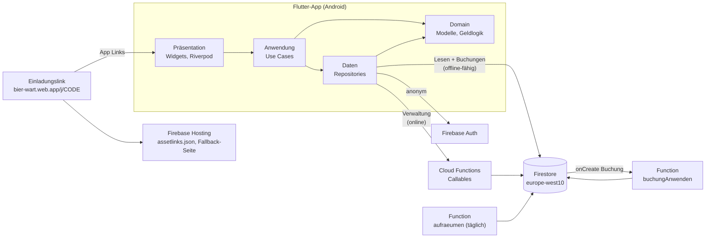
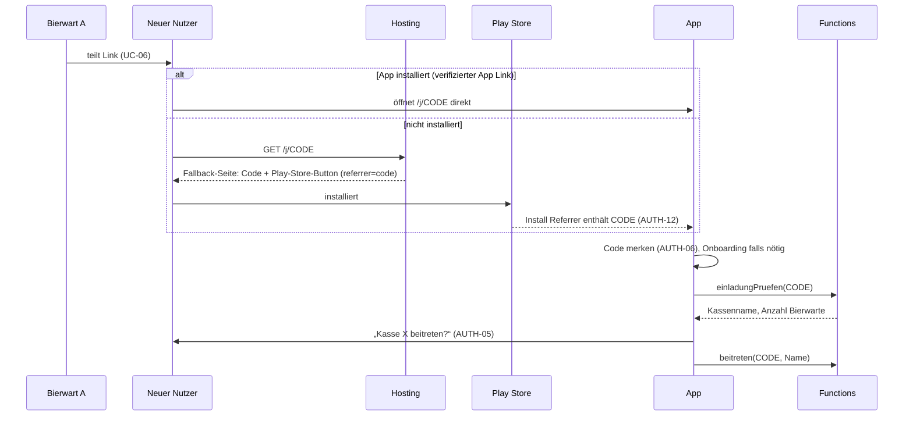

# Bierwart – Architektur (Entwurf)

- **Status:** Entwurf, Stand 2026-10-20. Punkte mit „Vorschlag“ sind noch nicht entschieden. Was offen ist, steht unter [Offene Fragen](#offene-fragen).
- **Grundlage:** [requirements.md](requirements.md), [styleguide.md](styleguide.md), [ADRs](decisions/README.md)

## Überblick



Zwei Arten von Schreibzugriffen:

| Art | Wer schreibt | Offline | Beispiele | Rechte geprüft durch |
| --- | --- | --- | --- | --- |
| **Buchungen** | App direkt in Firestore | ja (NFA-02) | Strich, Zahlung, Einkauf, Übergabe, Ein-/Auszahlung, Kassensturz, Bestand korrigieren, Storno | Security Rules |
| **Verwaltung** | App ruft Callable Function | nein, braucht Netz | Kasse erstellen, beitreten, Link erneuern, Rollen, Bierwart entfernen, austreten, auflösen, Admin wiederherstellen | Function (Admin SDK) |

Stammdaten (Mitglieder und Sorten anlegen oder umbenennen, Sorte ausblenden) schreibt die App direkt, ebenfalls offline-fähig und durch Rules geprüft.

## Schichten in der App

Feature-first, innerhalb eines Features nach Schichten:

```
lib/
  main.dart                    Einstieg: Firebase init, ProviderScope
  firebase_options.dart        generiert (FlutterFire)
  src/
    app.dart                   MaterialApp, Theme, Routing
    core/
      theme/                   Tokens, ThemeData, ThemeExtensions
      money/                   Cent-Formatierung und -Parsing (ADR-0002)
      firebase/                Provider für Auth, Firestore, Functions; Emulator-Schalter
      routing/                 Routen und Guards (Onboarding vs. Kasse)
      widgets/                 Neumorphe Grundbausteine (Button, Card, Tile, Sheet, TabBar)
    features/
      onboarding/              Willkommen, Kasse erstellen, Code, Einladen, Beitreten, Name
      strichliste/             Tab 01
      kader/                   Tab 02, Mitglied-Detail
      lager/                   Tab 03, Einkauf, Sorte bearbeiten
      geld/                    Tab 04, Sheets, Verlauf
      einstellungen/           Einstellungen, Rollen, Austreten, Auflösen
      <feature>/
        domain/                reine Dart-Modelle und Regeln, ohne Flutter und Firebase
        data/                  Repositories, Firestore-Mapping
        application/           Notifier / Use Cases
        presentation/          Widgets, Seiten, Sheets
```

Regeln:

- **Domain** kennt weder Flutter noch Firebase. Hier liegen Modelle (`Mitglied`, `Sorte`, `Buchung`, `Ort`) und die Wirkung einer Buchung auf Salden und Bestand. Diese Logik ist in Dart **und** in der Function `buchungAnwenden` nötig. Sie muss in beiden Sprachen mit denselben Testfällen geprüft werden.
- **Data** kapselt Firestore und die Callables. Nur hier werden Collections und Feldnamen verwendet.
- **Application** verbindet beides über Riverpod (ADR-0001).
- **Presentation** liest nur Provider, keine Firestore-Typen.
- Routing: Vorschlag `go_router` mit Redirect je nach Zustand (nicht angemeldet → Onboarding, in Kasse → Strichliste, UI-01).

## Datenmodell in Firestore

Alle Daten einer Kasse liegen unter `kassen/{kasseId}`. So bleiben die Rules einfach, und das Auflösen ist ein rekursives Löschen eines Teilbaums. Geld ist immer `int` in Cent (ADR-0002).

```
users/{uid}                                  nur Function schreibt; Nutzer liest eigenes Dokument
kassen/{kasseId}
  bierwarte/{uid}
  uebernahmen/{anfrageId}                    „Das bin ich“-Anfragen (ADR-0008)
  mitglieder/{mitgliedId}
  namen/{nameKey}                            Eindeutigkeitsindex für Namen
  sorten/{sorteId}
  orte/{ortId}                               "kasse" oder uid eines (ehemaligen) Bierwarts
  buchungen/{buchungId}                      unveränderliches Log
  intern/geheim                              nur Functions (Hash Wiederherstellungscode)
einladungen/{code}                           nur Functions
wiederherstellung/{codeHash}                 nur Functions
```

### Dokumente

| Pfad | Felder | Geschrieben von |
| --- | --- | --- |
| `users/{uid}` | `kasseId` (Release 4: Liste, AUTH-14) | Functions |
| `kassen/{k}` | `name`, `adminUid`, `kassenwartUid`, `einladungCode`, `einladungGueltigBis`, `anzahlBierwarte`, `leerSeit` (null oder Timestamp, AUTH-10), `letzteBuchungAm` (AUTH-11), `erstelltAm` | Functions |
| `kassen/{k}/bierwarte/{uid}` | `mitgliedId`, `name` (denormalisiert für Stempel), `beigetretenAm` | Functions |
| `kassen/{k}/mitglieder/{id}` | `name`, `nameKey`, `istGast` (KAD-03), `bierwartUid` (oder null), `entfernt` (bool), `saldoCents` (offen; negativ = Guthaben), `angelegtAm` | App (Name, Entfernen), Functions (Saldo, Bierwart-Verknüpfung) |
| `kassen/{k}/uebernahmen/{id}` | `neueUid`, `mitgliedId`, `status` (`offen`/`bestaetigt`/`abgelehnt`), `angefragtAm`, `entschiedenVon` (uid), `entschiedenAm` | Functions |
| `kassen/{k}/namen/{nameKey}` | `mitgliedId` | App, im selben Batch wie Anlegen/Umbenennen |
| `kassen/{k}/sorten/{id}` | `name`, `preisCents`, `aktiv` (Ausblenden, BES-01), `bestand` (Flaschen, darf < 0, STR-05), `reihenfolge` | App (Name, Preis, aktiv), Functions (Bestand) |
| `kassen/{k}/orte/{ortId}` | `art` (`kasse`/`portemonnaie`), `uid`, `name`, `standCents`, `ehemalig` (GEL-08) | Functions |
| `kassen/{k}/buchungen/{id}` | siehe unten | App (anlegen), Function (nur `angewendet`, `fehler`, `differenz`, `differenzCents`) |
| `kassen/{k}/intern/geheim` | `wiederherstellungHash` | Functions |
| `einladungen/{code}` | `kasseId`, `gueltigBis`, `ersetzt` (bool) | Functions |
| `wiederherstellung/{codeHash}` | `kasseId` | Functions |

`nameKey` ist der normalisierte Name (klein, Leerzeichen zusammengefasst, Unicode NFC). Das Dokument `namen/{nameKey}` sorgt dafür, dass ein Name pro Kasse nur einmal vorkommt (AUTH-07, UI-09). Ein zweites `create` auf denselben Schlüssel scheitert an den Rules.

### Buchungen (das Log)

Jede Buchung ist ein eigenes, **unveränderliches** Dokument (LOG-01, LOG-02). Die App erzeugt die ID selbst. Deshalb funktioniert das offline, und zwei gleichzeitige Buchungen überschreiben sich nie (NFA-03).

Gemeinsame Felder:

| Feld | Inhalt |
| --- | --- |
| `typ` | siehe Tabelle unten |
| `stempel` | `{ uid, name, am: serverTimestamp, geraetAm: Client-Zeit }` (Stempel) |
| `angewendet` | `false` beim Anlegen; die Function setzt `true`, sobald die Wirkung in den Aggregaten steckt |
| `bezugId` | bei `storno`: ID der stornierten Buchung |

| `typ` | Zusatzfelder | Wirkung | Anforderung |
| --- | --- | --- | --- |
| `strich` | `mitgliedId`, `sorteId`, `preisCents` (Preis zum Buchungszeitpunkt) | Saldo + Preis, Bestand − 1 | STR-02, BES-02 |
| `strichBar` | `mitgliedId`, `sorteId`, `preisCents`, `ortId` | Bestand − 1, Ort + Preis | STR-03, KAD-03 |
| `storno` | `bezugId` und die Felder der Ursprungsbuchung | Gegenwirkung der Ursprungsbuchung | STR-04, STR-06 |
| `zahlung` | `mitgliedId`, `betragCents`, `ortId` | Saldo − Betrag, Ort + Betrag | GEL-02, GEL-03 |
| `einkauf` | `zeilen: [{sorteId, anzahl}]`, `betragCents`, `ortId` | Bestand + Anzahl je Zeile, Ort − Betrag | BES-04, BES-05 |
| `bestandKorrektur` | `sorteId`, `gezaehlt` | Bestand = gezählt; die Function rechnet `differenz` beim Anwenden aus | BES-06 |
| `uebergabe` | `vonOrtId`, `nachOrtId`, `betragCents` | von − Betrag, nach + Betrag | GEL-04 |
| `einzahlung` / `auszahlung` | `ortId`, `betragCents`, `grund` | Ort ± Betrag | GEL-05 |
| `kassensturz` | `gezaehltCents` | Kasse = gezählt; die Function rechnet `differenzCents` beim Anwenden aus | GEL-06 |
| `mitgliedAngelegt`, `mitgliedUmbenannt`, `mitgliedEntfernt`, `sorteGeaendert`, … | jeweils alt/neu | keine Geldwirkung, nur Log | LOG-01, UI-09 |
| `rolleGeaendert`, `bierwartBeigetreten`, `bierwartEntfernt`, `ausgetreten`, `einladungErneuert`, `kasseUmbenannt`, `uebernahmeAngefragt`, `uebernahmeBestaetigt`, `uebernahmeAbgelehnt` | jeweils alt/neu | nur Log, von Functions geschrieben | LOG-01, ADM-01 bis ADM-06 |

„Rückgängig“ in der Snackbar (STR-04) erzeugt eine `storno`-Buchung, löscht also nichts.

### Aggregate: Salden, Bestand, Ortsstände

Die Bildschirme brauchen Salden, Bestand und Ortsstände sofort, ohne jedes Mal alle Buchungen zu lesen (NFA-12, Kosten).

**Entschieden: serverseitige Aggregation per Trigger** ([ADR-0007](decisions/0007-aggregation-per-trigger.md)).

1. Die App legt nur die Buchung an (`angewendet: false`).
2. Die Function `buchungAnwenden` (Firestore `onDocumentCreated`) wendet die Wirkung in **einer Transaktion** auf `mitglieder.saldoCents`, `sorten.bestand` und `orte.standCents` an. Danach setzt sie `angewendet: true` und `kassen.letzteBuchungAm`. Weil Trigger mindestens einmal feuern, prüft sie in der Transaktion zuerst `angewendet`. So ist der Trigger idempotent.
3. Die App zeigt **Aggregat + Wirkung aller noch nicht angewendeten Buchungen**. Dafür hört sie auf `buchungen where angewendet == false`. Das sind fast immer nur wenige Dokumente. Darin stecken auch eigene Offline-Buchungen und Buchungen anderer Geräte, die die Function noch nicht verarbeitet hat. So ist eine Buchung lokal sofort sichtbar (NFA-06), offline korrekt (NFA-02) und auf anderen Geräten sichtbar, sobald sie synchronisiert ist, unabhängig von der Trigger-Latenz (NFA-05).

`bestandKorrektur` und `kassensturz` setzen absolute Werte. Die Function rechnet sie beim Anwenden in eine Differenz zum aktuellen Stand um und speichert diese an der Buchung. Damit sind alle angewendeten Wirkungen reine Plus- und Minusbeträge, und die Reihenfolge der Trigger spielt keine Rolle.

Die Wirkung einer Buchung ist deshalb **zweimal implementiert**: in Dart (Anzeige) und in TypeScript (Function). Gemeinsame Testfälle als JSON-Fixtures unter `fixtures/buchungswirkung/` halten beide gleich.

Verworfene Alternative: Die App schreibt Buchung und `FieldValue.increment()` auf die Aggregate in einem Batch, und die Rules prüfen mit `getAfter()`, ob die Inkremente zur Buchung passen. Das geht ohne Function und ohne Doppel-Implementierung. Aber ein Einkauf mit vielen Zeilen sprengt das Limit von 20 `get`-Aufrufen pro Anfrage, und die Rules werden schwer prüfbar. Details in ADR-0007.

### Abfragen und Indizes

| Bildschirm | Abfrage |
| --- | --- |
| Strichliste | `sorten where aktiv == true`, `mitglieder where entfernt == false`, unangewendete Buchungen |
| Kader | `mitglieder where entfernt == false` (Sortierung nach Saldo im Client, KAD-05) |
| Mitglied-Detail | `buchungen where mitgliedId == X orderBy stempel.am desc` (Index nötig, KAD-06) |
| Geld | `orte`, `kassen/{k}` |
| Verlauf | `buchungen orderBy stempel.am desc`, optional `where stempel.uid == X` oder `mitgliedId == X`, seitenweise (LOG-03) |

Zusammengesetzte Indizes kommen in `firestore.indexes.json`.

## Security Rules

Grundsätze (NFA-07):

- Ohne Anmeldung kein Zugriff. Jeder Zugriff unter `kassen/{k}` setzt voraus, dass `kassen/{k}/bierwarte/{request.auth.uid}` existiert.
- Clients schreiben **nie** in `kassen/{k}`, `bierwarte`, `orte`, `intern`, `users`, `einladungen` und `wiederherstellung`. Das machen nur Functions mit dem Admin SDK.
- Aggregatfelder (`saldoCents`, `bestand`, `standCents`) sind für Clients schreibgeschützt.
- Buchungen: nur `create`, nie `update`/`delete` (LOG-02).

Skizze:

```
function signedIn() { return request.auth != null; }
function kasse(k) { return get(/databases/$(database)/documents/kassen/$(k)).data; }
function istBierwart(k) { return signedIn() && exists(/databases/$(database)/documents/kassen/$(k)/bierwarte/$(request.auth.uid)); }
function istKassenwart(k) { return istBierwart(k) && kasse(k).kassenwartUid == request.auth.uid; }

match /kassen/{k} {
  allow read: if istBierwart(k);
  allow write: if false;

  match /bierwarte/{uid} { allow read: if istBierwart(k); allow write: if false; }
  match /orte/{ortId}    { allow read: if istBierwart(k); allow write: if false; }
  match /uebernahmen/{id} {                       // ADR-0008
    allow read: if istBierwart(k) || (signedIn() && resource.data.neueUid == request.auth.uid);
    allow write: if false;
  }
  match /intern/{doc}    { allow read, write: if false; }

  match /mitglieder/{id} {
    allow read: if istBierwart(k);
    allow create: if istBierwart(k) && neuesMitgliedGueltig()          // saldoCents == 0, namen/{key} im selben Batch (existsAfter)
    allow update: if istBierwart(k) && nurFelder(['name','nameKey','entfernt'])
                  && (!request.resource.data.entfernt || resource.data.saldoCents == 0)   // KAD-04
                  && !resource.data.istGast;                                            // Gäste nicht löschbar
  }
  match /namen/{key} { allow read: if istBierwart(k); allow create, delete: if istBierwart(k) && …; }

  match /sorten/{id} {
    allow read: if istBierwart(k);
    allow create: if istBierwart(k) && request.resource.data.bestand == 0 && request.resource.data.preisCents is int;
    allow update: if istBierwart(k) && nurFelder(['name','preisCents','aktiv','reihenfolge']);
  }

  match /buchungen/{id} {
    allow read: if istBierwart(k);
    allow create: if istBierwart(k)
      && request.resource.data.stempel.uid == request.auth.uid
      && request.resource.data.angewendet == false
      && buchungGueltig(k, request.resource.data);   // je typ: Pflichtfelder, Beträge int > 0,
                                                     // ortId == eigene uid ODER ("kasse" und istKassenwart),
                                                     // uebergabe/kassensturz nur Kassenwart
    allow update, delete: if false;
  }
}
match /users/{uid} { allow read: if signedIn() && request.auth.uid == uid; allow write: if false; }
match /{document=**} { allow read, write: if false; }
```

Die Rules werden mit `@firebase/rules-unit-testing` gegen den Firestore-Emulator getestet: je Regel ein erlaubter und ein verbotener Fall.

## Cloud Functions

TypeScript, 2nd gen, Admin SDK. Region: **alle Functions in `europe-west10`**, wie die Firestore-Datenbank. Firestore-Trigger müssen in der Region der Datenbank laufen, und Callables liegen so neben ihren Daten. Die Region wird im Code global gesetzt (`setGlobalOptions({ region: "europe-west10" })`). Daten und Verarbeitung liegen damit in Deutschland (NFA-09).

### Callables (brauchen Netz, die App zeigt sonst eine klare Meldung, NFA-10)

| Function | Wer | Tut | Anforderungen |
| --- | --- | --- | --- |
| `kasseErstellen(name, eigenerName, startCents)` | jeder angemeldete Nutzer ohne Kasse | Legt Kasse, Gäste-Mitglied, eigenes Mitglied, Bierwart, Orte (Kasse mit Startbetrag, eigenes Portemonnaie 0), Einladungscode und Wiederherstellungscode (Hash) an. Gibt den Code **einmal** zurück. | UC-01, AUTH-02, AUTH-03 |
| `einladungPruefen(code)` | jeder angemeldete Nutzer | Gibt Kassenname und Anzahl Bierwarte zurück oder einen Fehler (abgelaufen, ersetzt) | AUTH-05, AUTH-08 |
| `beitreten(code, name)` | jeder angemeldete Nutzer | Prüft Code serverseitig. Legt Mitglied + Bierwart + Portemonnaie an. Ist der Name vergeben, kommt ein Fehler mit der `mitgliedId`, damit die App „Das bin ich“ anbieten kann | UC-02, AUTH-07, AUTH-08 |
| `uebernahmeAnfragen(code, mitgliedId)` | jeder angemeldete Nutzer | Prüft Code serverseitig und legt eine offene Anfrage an. Hat das Mitglied keinen anderen aktiven Bierwart neben sich, lehnt die Function ab und verweist auf den Wiederherstellungscode | UC-03, AUTH-07 |
| `uebernahmeEntscheiden(anfrageId, bestaetigen)` | aktiver Bierwart der Kasse | Bei Bestätigung: Mitgliedschaft, Portemonnaie und Rollen gehen auf die neue UID über, die alte UID verliert den Zugang, `users/{neueUid}.kasseId` wird gesetzt. Bei Ablehnung: nur Status | UC-03, AUTH-07, ADR-0008 |
| `einladungErneuern()` | Admin | Neuer Code, alter sofort `ersetzt` | ADM-01, UC-07 |
| `bierwartEntfernen(uid)` | Admin | Zugang weg, Mitglied bleibt, Portemonnaie `ehemalig`, Link erneuert | ADM-02, UC-08, GEL-08 |
| `rolleUebertragen(rolle, uid)` | Admin | Kassenwart bestimmen oder Admin übergeben | ADM-03, UC-09 |
| `kasseUmbenennen(name)` | Admin | | ADM-04 |
| `kasseAufloesen(bestaetigungName)` | Admin | Prüft den abgetippten Namen, löscht `kassen/{k}` rekursiv, dazu Einladungen, Wiederherstellungseintrag und `users/*.kasseId` | ADM-05, UC-10 |
| `adminWiederherstellen(code)` | jeder angemeldete Nutzer | Hash nachschlagen; Nutzer wird Bierwart (falls nötig) und Admin, bisheriger Admin normaler Bierwart; `leerSeit` zurücksetzen | ADM-06, UC-04, AUTH-10 |
| `austreten(nachfolger?)` | Bierwart | Nur bei Portemonnaie = 0. Admin/Kassenwart müssen einen Nachfolger angeben. Mitglied bleibt. Letzter Bierwart → `leerSeit = jetzt` | AUTH-09, UC-05, KAD-02 |

Jede Callable schreibt ihre Log-Buchung im selben Batch wie die Änderung.

### Trigger

| Function | Auslöser | Tut |
| --- | --- | --- |
| `buchungAnwenden` | `onDocumentCreated kassen/{k}/buchungen/{id}` | Wendet die Wirkung idempotent auf die Aggregate an (siehe oben). Ungültige Buchungen, die die Rules durchgelassen haben, werden nicht angewendet, sondern markiert (`angewendet: true`, `fehler`). |

### Zeitgesteuert: automatisches Löschen

`aufraeumen`, täglich (Cloud Scheduler, im Blaze-Tarif enthalten):

| Regel | Abfrage | Anforderung |
| --- | --- | --- |
| Kasse ohne Bierwarte seit 30 Tagen | `kassen where leerSeit <= jetzt − 30 Tage` | AUTH-10 |
| Kasse ohne Buchung seit 12 Monaten | `kassen where letzteBuchungAm <= jetzt − 12 Monate` | AUTH-11 |
| Abgelaufene Einladungen | `einladungen where gueltigBis <= jetzt − 7 Tage` | Hygiene |

Gelöscht wird mit `firestore.recursiveDelete()`, dieselbe Routine wie bei `kasseAufloesen`. Jeder Lauf schreibt die gelöschten IDs ins Function-Log.

## Einladungslinks: Hosting + App Links

Format: `https://bier-wart.web.app/j/{code}`. `code` ist zufällig und URL-sicher. Der Link ist 7 Tage gültig. Geprüft wird immer serverseitig in `einladungPruefen`/`beitreten` (AUTH-08).



Bausteine:

- **Hosting** (`hosting/public/`):
  - `/.well-known/assetlinks.json` mit Paketname (`io.github.markra711.bierwart`) und SHA-256-Fingerabdrücken. Header `Content-Type: application/json`.

    | Schlüssel | SHA-256 | Stand |
    | --- | --- | --- |
    | Debug (`~/.android/debug.keystore` auf Marvins Rechner) | `99:AC:29:B1:25:49:3C:32:40:8A:D0:82:41:0F:A2:93:C8:71:E8:48:61:D2:32:00:00:AE:EB:5B:E8:F9:19:29` | aktiv, für Tests auf eigenen Geräten |
    | Upload-Key | – | kommt mit dem Store-Release |
    | Play App Signing | – | kommt mit dem Store-Release |

    Jeder Rechner hat einen eigenen Debug-Key. Wer auf einem anderen Rechner baut, muss dessen Fingerabdruck ergänzen, sonst öffnen sich Links dort im Browser statt in der App.
  - `firebase.json`-Rewrite `/j/**` → `/j.html`: eine statische Seite, die den Code aus der URL zeigt, einen Play-Store-Link mit `&referrer=code%3D{code}` anbietet und den Code zum Kopieren bereitstellt (für „Link einfügen“).
- **Android**: `intent-filter` mit `android:autoVerify="true"` für `https://bier-wart.web.app/j/*` in `AndroidManifest.xml`.
- **App**: Paket `app_links` empfängt eingehende Links. Paket für den Play Install Referrer (z. B. `play_install_referrer`) liest den Code nach der Erstinstallation (AUTH-12). Ein offener Code wird in `shared_preferences` gemerkt, bis die Namenswahl fertig ist (AUTH-06).
- **iOS** (Release 3, AUTH-13): Universal Links über `apple-app-site-association` auf derselben Domain.

## Offline, Gleichzeitigkeit, Fehler

- Firestore-Offline-Persistenz ist auf Android standardmäßig an. Buchungen und Stammdaten werden lokal geschrieben und später synchronisiert (NFA-02).
- Jede Buchung ist ein neues Dokument mit Client-ID. Es gibt keine Read-Modify-Write-Zyklen auf dem Client und damit keine verlorenen Updates (NFA-03).
- Lehnen die Rules eine Offline-Schreibung beim Sync ab (z. B. Name inzwischen vergeben), meldet die App das sichtbar (NFA-10). Dafür müssen die Write-Futures beobachtet werden, auch nach dem Verlassen des Bildschirms (globaler Fehlerkanal, Snackbar).
- Callables haben ein Timeout. Ohne Netz zeigt die App sofort „Dafür brauchst du Netz“, statt endlos zu laden.

## Lokale Entwicklung und Tests

- Emulatoren: Auth, Firestore, Functions (und Hosting für die Fallback-Seite). Lokal mit Demo-Projekt `demo-bierwart`, damit nie echte Daten berührt werden.
- Die App verbindet sich im Debug-Build mit den Emulatoren, wenn sie mit `--dart-define=USE_EMULATORS=true` gestartet wird.
- Tests:
  - Dart: Unit-Tests für Domain (Geld, Buchungswirkung), Widget-Tests für Bildschirme.
  - Rules: `@firebase/rules-unit-testing` gegen den Emulator (NFA-07).
  - Functions: Tests gegen den Emulator.
  - Gemeinsame Fixtures für die Buchungswirkung (Dart und TypeScript).
- CI (GitHub Actions): `flutter analyze`, `flutter test`. Rules- und Functions-Tests kommen dazu, sobald es `functions/` gibt.

## Vor dem ersten Deploy

Bis dahin läuft alles lokal gegen die Emulatoren. Das Projekt bleibt im Spark-Tarif.

- [ ] Projekt `bier-wart` auf den Blaze-Tarif umstellen (Konsole, macht Marvin). Nötig für Cloud Functions und Cloud Scheduler (ADR-0003, ADR-0007, ADR-0008, AUTH-10, AUTH-11).
- [ ] Budget-Alarm von 1 € im Monat einrichten (NFA-12). Der Alarm warnt nur, er begrenzt die Kosten nicht.
- [ ] Security Rules mit Emulator-Tests fertig, bevor irgendetwas deployt wird (NFA-07).
- [ ] Beim ersten Deploy prüfen, dass der Firestore-Trigger `buchungAnwenden` in `europe-west10` angelegt wird. Der Emulator prüft Regionen nicht.
- [ ] Deploy nur mit ausdrücklicher Freigabe (siehe `CLAUDE.md`).

## Vor dem Store-Release

Aufgaben, die erst mit dem Play-Store-Eintrag anfallen. Keine davon blockiert die Entwicklung.

- [ ] Entwicklerkonto in der Play Console und App `io.github.markra711.bierwart` anlegen (Konsole, macht Marvin).
- [ ] Upload-Key erzeugen, sicher verwahren (nicht im Repo), Signierung in `android/app/build.gradle.kts` über `key.properties` einrichten.
- [ ] SHA-256 von Upload-Key und Play App Signing in `assetlinks.json` eintragen (AUTH-04).
- [ ] SHA-1 des Release-Keys in der Firebase-Konsole bei der Android-App hinterlegen.
- [ ] Android-API-Key in der Google Cloud Console auf Paketname und SHA-1 (Debug + Release) einschränken. Der Key steht öffentlich in der APK; die Einschränkung verhindert, dass fremde Apps ihn benutzen.
- [ ] App Links mit dem Release-Build auf einem echten Gerät prüfen (`adb shell pm get-app-links io.github.markra711.bierwart`).

## Kosten (grobe Schätzung, NFA-12)

Annahme: eine Mannschaft, 5 Bierwarte, 30 Mitglieder, ca. 5.000 Buchungen pro Jahr.

- Schreiben: ca. 15 Buchungen am Tag, je 1 Client-Schreibvorgang + ca. 3–4 durch den Trigger. Weit unter dem Gratiskontingent.
- Lesen: Listener auf Mitglieder, Sorten, Orte und unangewendete Buchungen. Verlauf und Mitglied-Detail seitenweise. Bleibt bei Nutzung von Offline-Cache und kurzen Wiederverbindungen voraussichtlich im Gratiskontingent.
- Functions, Scheduler, Hosting: im Gratisrahmen.

Diese Schätzung ist zu prüfen, sobald es echte Nutzung gibt.

## Offene Fragen

Ich habe sie nicht entschieden. Jede braucht eine Antwort, bevor der jeweilige Teil gebaut wird.

1. ~~**Aggregation**~~ – entschieden: per Trigger ([ADR-0007](decisions/0007-aggregation-per-trigger.md)).
2. ~~**„Das bin ich (neues Gerät)“ absichern**~~ – entschieden: Bestätigung durch einen anderen aktiven Bierwart ([ADR-0008](decisions/0008-uebernahme-bestaetigung.md)). Daraus folgen die Fragen 21 bis 23.
3. ~~**Paketname / applicationId**~~ – entschieden: `io.github.markra711.bierwart` ([ADR-0006](decisions/0006-paketname.md)). Offen ist nur noch der Schritt in der Konsole: eine neue Android-App mit diesem Paketnamen registrieren und die neue `google-services.json` einspielen, danach `firebase_options.dart` neu erzeugen.
4. ~~**SHA-256-Fingerabdrücke**~~ – entschieden: zunächst nur der Debug-Key (siehe [Einladungslinks](#einladungslinks-hosting--app-links)); Upload-Key und Play App Signing stehen unter [Vor dem Store-Release](#vor-dem-store-release).
5. ~~**Blaze-Tarif**~~ – entschieden: Spark bis zum ersten Deploy, dann Blaze mit Budget-Alarm (siehe [Vor dem ersten Deploy](#vor-dem-ersten-deploy)).
6. ~~**Functions-Region**~~ – entschieden: alle Functions in `europe-west10` (siehe [Cloud Functions](#cloud-functions)).
7. **Sprache der Functions:** TypeScript (Vorschlag) oder Dart/anderes?
8. **Storno eines Bar-Strichs (STR-06):** Erscheinen bar bezahlte Striche im Mitglied-Detail und sind sie stornierbar? Wenn ja: Geht das Geld aus dem Portemonnaie dessen zurück, der ihn gebucht hat, oder dessen, der storniert?
9. **„Rückgängig“ (STR-04):** Gibt es ein Zeitfenster, nach dem die Snackbar-Aktion verschwindet, und darf nur der Buchende rückgängig machen?
10. **Gäste-Buchungen (KAD-03):** „standardmäßig sofort bar“: Heißt Tippen auf „Gäste“ dann bar und Halten offen, oder immer bar?
11. **Kassensturz offline:** Darf er offline gebucht werden? Die Differenz berechnet die Function erst beim Anwenden, die App zeigt vorher nur eine vorläufige.
12. **Wiederherstellungscode:** Format und Länge (Lesbarkeit vs. Sicherheit) und Schutz gegen Durchprobieren (App Check, Rate Limit)? Kann der Admin einen neuen Code erzeugen, wenn der alte verloren ist?
13. **App Check** (Play Integrity) für Functions und Firestore in Release 1 aktivieren?
14. **Verwaiste anonyme Nutzer** in Firebase Auth (z. B. nach Neuinstallation): aufräumen, und wenn ja, nach welcher Frist?
15. **Schriften offline:** `google_fonts` lädt zur Laufzeit. Barlow und Barlow Condensed als Assets bündeln (Vorschlag), damit die App beim ersten Start ohne Netz richtig aussieht?
16. **Innere Schatten:** eigener Painter oder Paket (z. B. `flutter_inset_shadow`)?
17. **Routing:** `go_router` (Vorschlag) in Ordnung?
18. **Datenschutzhinweis (NFA-09):** Wer liefert den Text, und reicht ein Bildschirm in den Einstellungen?
19. **Quelle der Wahrheit für Anforderungen:** Das Online-Dokument oder `docs/requirements.md`? Wie werden Änderungen synchronisiert?
20. **Mitglied-Namen (KAD-01) und Eindeutigkeit:** Gilt die Eindeutigkeit für alle Mitglieder oder nur für Bierwarte? Zählen entfernte Mitglieder mit?
21. **Übernahme eines Mitglieds ohne App:** Ist der vergebene Name ein Mitglied, das nie Bierwart war (z. B. ein Spieler wird Bierwart), gibt es weder Portemonnaie noch Rollen zu schützen. Braucht das trotzdem eine Bestätigung, oder verknüpft `beitreten` direkt?
22. **Ablauf einer Übernahme-Anfrage:** Verfällt eine offene Anfrage (z. B. mit dem Einladungslink nach 7 Tagen), und darf das neue Gerät sie zurückziehen?
23. **Wo sehen Bierwarte offene Anfragen?** Hinweis auf der Strichliste, in den Einstellungen oder beides? Warte-Bildschirm und Anfrage-Ansicht fehlen im Design-Canvas.
