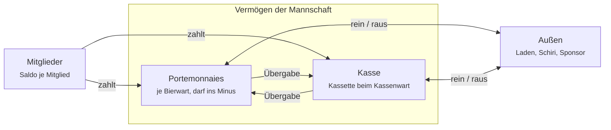

# Bierwart – Anforderungen

> **Diese Datei ist die maßgebliche Fassung der Anforderungen** (seit 2026-10-21). Änderungen entstehen hier, im selben Commit wie der Code, der sie betrifft (siehe `CLAUDE.md`).
>
> Ursprung: das Online-Dokument [„Bierwart – Anforderungen“](https://claude.ai/code/artifact/2f47fa84-46ad-4910-ab27-16ca8f10dbf0) von Marvin, Stand 2026-10-19. Es ist seit 2026-10-21 **eingefroren** und wird nicht mehr gepflegt. Die IDs sind unverändert übernommen, die Diagramme als Mermaid bzw. Tabelle nachgebaut.
>
> **Änderungen seit dem Ursprung** (bis 2026-10-21 auch ins Online-Dokument übertragen):
> - 2026-10-21: UC-03 und AUTH-07 – Übernahme braucht die Bestätigung eines Bierwarts ([ADR-0008](decisions/0008-uebernahme-bestaetigung.md)).
> - 2026-10-21: AUTH-10 und AUTH-11 in Release 2, ADM-05 ohne „serverseitig“, Annahme zu Cloud Functions angepasst – Release 1 ohne Cloud Functions ([ADR-0009](decisions/0009-release-1-ohne-cloud-functions.md)).
> - 2026-10-21: KAD-03 – Buchungen auf „Gäste“ sind immer bar, nicht nur standardmäßig (architecture.md, offene Frage 10).
> - 2026-10-21, nach dem Einfrieren: ADM-08 neu – Admin kann einen neuen Wiederherstellungscode erzeugen (architecture.md, offene Frage 12).
> - 2026-10-21, nach dem Einfrieren: KAD-08 neu – entfernte Mitglieder behalten ihren Namen und lassen sich wieder aufnehmen (architecture.md, offene Frage 20).
> - 2026-10-21, nach dem Einfrieren: AUTH-07 – bei der Übernahme per Wiederherstellungscode wird das alte Portemonnaie ehemalig, weil der Stand vorher nicht lesbar ist (architecture.md, Verwaltung als Batches).
> - 2026-10-22, nach dem Einfrieren: STR-06 – auch Zahlungen lassen sich stornieren (architecture.md, offene Frage 24).
> - 2026-10-28, nach dem Einfrieren: AUTH-15 neu, UC-05 ergänzt – Austreten und Auflösen löschen das anonyme Konto; Name und Buchungen bleiben im Verlauf (LOG-02). Grund: Richtlinie von Google Play zur Kontolöschung (architecture.md, Vor dem Store-Release).
> - 2026-10-28, nach dem Einfrieren: NFA-09 – zusätzlich Datenschutzerklärung und Löschseite im Web, weil Google Play beides als URL verlangt (architecture.md, offene Frage 18).
> - 2026-10-28, nach dem Einfrieren: NFA-13 neu – Nutzungsbedingungen, Zustimmung beim Erstellen und Beitreten, „Melden“. Grund: Richtlinie von Google Play zu nutzergenerierten Inhalten (architecture.md, Vor dem Store-Release).

## Vision & Abgrenzung

Bierwart ersetzt die Papier-Strichliste am Getränkekasten einer Amateurmannschaft. Mehrere Bierwarte buchen gemeinsam und live, und jederzeit ist klar, wer was schuldet, was im Lager steht und wo das Geld liegt.

**Ziele**

- Ein Getränk ist in zwei Tipps gebucht: Sorte wählen, Mitglied antippen.
- Offene Beträge aller Mitglieder sind auf einen Blick sichtbar und lassen sich als Text in die Mannschaftsgruppe teilen.
- Jeder Euro ist einem Ort zugeordnet: der Kasse oder dem Portemonnaie eines Bierwarts.
- Jede Aktion trägt den Stempel des Bierwarts, der sie ausgeführt hat.

**Nicht Teil von Bierwart**

- Strafenkasse und Strafkataloge. Bierwart bleibt eine Getränke-App.
- Zugang für Spieler. Nur Bierwarte nutzen die App, Spieler sind Einträge im Kader.
- Konten mit E-Mail oder Passwort.
- Online-Zahlungen. Bezahlt wird bar.

## Rollen & Begriffe

Alle Bierwarte haben dieselben Rechte beim Buchen. Zwei Rollen kommen obendrauf, die jeweils genau ein Bierwart innehat.

| Begriff | Wer | Darf zusätzlich |
| --- | --- | --- |
| **Kasse** | die Mannschaftskasse als Ganzes: Kader, Getränke, Bestand, Geld, Log | – |
| **Mitglied** | Eintrag im Kader mit Vor- und Nachname in einem Feld; hat einen offenen Betrag oder ein Guthaben | nutzt die App nicht |
| **Gast** | fester Kader-Eintrag „Gäste“ für Schiri, Gegner, Eltern; nicht löschbar | – |
| **Bierwart** | App-Nutzer, der der Kasse beigetreten ist; steht automatisch als Mitglied im Kader und hat ein eigenes Portemonnaie | buchen, einkaufen, kassieren, Mitglieder und Getränke pflegen, Einladungslink teilen, austreten |
| **Kassenwart** | genau ein Bierwart, verwahrt die physische Kasse | Geld in die Kasse oder aus ihr buchen, Übergaben von Bierwarten annehmen, Kassensturz |
| **Admin** | genau ein Bierwart, zu Beginn der Ersteller | Einladungslink erneuern, Bierwarte entfernen, Kassenwart bestimmen, Kasse umbenennen und auflösen, Admin-Rolle übergeben |

- **Portemonnaie:** das Geld, das ein Bierwart für die Kasse bei sich trägt. Es kann negativ sein. Dann schuldet die Kasse ihm Geld (Auslage).
- **Offener Betrag:** Summe der unbezahlten Striche eines Mitglieds minus seiner Zahlungen. Negativ heißt Guthaben.
- **Stempel:** Name des Bierwarts und Zeitpunkt, an jeder Buchung und jedem Log-Eintrag.
- **Einladungslink:** Link mit Beitrittscode, 7 Tage gültig.
- **Wiederherstellungscode:** geheimer Code, der beim Erstellen der Kasse einmal angezeigt wird. Wer ihn eingibt, wird Admin.

## Geld-Modell

Geld liegt immer an genau einem Ort: in der Kasse oder im Portemonnaie eines Bierwarts. Das Vermögen der Mannschaft ist die Summe aus beidem.

*Jeder Euro liegt in der Kasse oder in einem Portemonnaie.*

Zahlt ein Mitglied, landet das Geld bei dem Bierwart, der kassiert. Nur der Kassenwart bucht direkt in die Kasse oder aus ihr. Ein Portemonnaie im Minus bedeutet, dass die Kasse dem Bierwart eine Auslage schuldet.

## Anwendungsfälle

Release 1 umfasst 20 Anwendungsfälle in fünf Gruppen. Akteur ist immer ein Bierwart, außer wo ein Rollenname steht.

| ID | Anwendungsfall | Akteur | Ergebnis |
| --- | --- | --- | --- |
| UC-01 | Kasse erstellen | neuer Nutzer | Kasse mit Name und Startbetrag existiert; Ersteller ist Admin und Kassenwart; Wiederherstellungscode wurde angezeigt |
| UC-02 | Per Link beitreten | neuer Nutzer | nach Bestätigung „Kasse X beitreten?“ und Namenswahl ist er Bierwart und Mitglied |
| UC-03 | Mit neuem Gerät zurückkehren | Bierwart | beim Beitritt mit vergebenem Namen wählt er „Das bin ich“; nach Bestätigung durch einen anderen aktiven Bierwart (als einziger Bierwart: per Wiederherstellungscode) übernimmt er die alte Mitgliedschaft |
| UC-04 | Admin-Rolle wiederherstellen | Bierwart | mit dem Wiederherstellungscode wird er Admin |
| UC-05 | Austreten | Bierwart | nur bei Portemonnaie = 0; Admin und Kassenwart übergeben vorher ihre Rolle; löscht das eigene Konto (AUTH-15) |
| UC-06 | Einladungslink teilen | Bierwart | Link geht über das Teilen-Menü raus |
| UC-07 | Einladungslink erneuern | Admin | neuer Link, der alte ist sofort ungültig |
| UC-08 | Bierwart entfernen | Admin | Zugang weg, Link erneuert, Person bleibt als Mitglied im Kader |
| UC-09 | Kassenwart bestimmen | Admin | Rolle wechselt, Log-Eintrag |
| UC-10 | Kasse umbenennen / auflösen | Admin | Auflösen nach Bestätigung und Abtippen des Kassennamens; alle Daten werden gelöscht |
| UC-11 | Mitglied anlegen / entfernen | Bierwart | Entfernen nur bei offenem Betrag = 0 |
| UC-12 | Getränkesorte anlegen / ändern / ausblenden | Bierwart | Sorte mit Name und Verkaufspreis |
| UC-13 | Einkauf erfassen | Bierwart | Bestand je Sorte steigt, Kosten gehen vom Portemonnaie des Bierwarts ab (beim Kassenwart wählbar: Kasse) |
| UC-14 | Bestand korrigieren | Bierwart | Bestand auf gezählten Wert gesetzt, Log-Eintrag |
| UC-15 | Strich buchen | Bierwart | Sorte wählen, Mitglied antippen: Strich offen, Bestand −1, Bestätigung mit „Rückgängig“ |
| UC-16 | Strich sofort bar bezahlt | Bierwart | langer Druck auf Mitglied: Strich bezahlt, Geld im Portemonnaie des Bierwarts |
| UC-17 | Strich stornieren | Bierwart | einzelner Strich im Mitglied-Detail zurückgenommen, Log-Eintrag |
| UC-18 | Zahlung annehmen | Bierwart | beliebiger Betrag verrechnet, Überzahlung wird Guthaben, Geld im Portemonnaie des Bierwarts |
| UC-19 | Geld übergeben / ausgeben / einzahlen | Kassenwart | Übergabe Portemonnaie → Kasse oder Kasse → Portemonnaie; Ein- und Auszahlungen mit Grund |
| UC-20 | Kassensturz | Kassenwart | gezählter Betrag eingetragen, Differenz als „Kassendifferenz“ gebucht |

Dazu kommen zwei lesende Fälle ohne eigene ID: die offenen Beträge als Text teilen und das Log mit allen Buchungen ansehen.

## Funktionale Anforderungen

Jede Anforderung hat eine ID und ein Release. Release 1 ist das MVP für Android, spätere Releases sind schon eingeplant, damit Release 1 ihnen nicht im Weg steht.

**Anmeldung, Beitritt, Austritt**

| ID | Die App muss … | Release |
| --- | --- | --- |
| AUTH-01 | Nutzer beim ersten Start anonym über Firebase anmelden, ohne Eingabe | 1 |
| AUTH-02 | beim Erstellen der Kasse Kassenname, eigenen Namen und Startbetrag abfragen | 1 |
| AUTH-03 | beim Erstellen einen Wiederherstellungscode genau einmal anzeigen, mit Hinweis, ihn zu speichern | 1 |
| AUTH-04 | Einladungslinks öffnen: App installiert → App öffnet sich; nicht installiert → Webseite mit Store-Link und Code | 1 |
| AUTH-05 | nach dem Öffnen eines Links „Kasse X beitreten?“ mit Kassenname und Anzahl Bierwarte fragen, Ja oder Nein | 1 |
| AUTH-06 | einen Link merken, der vor dem Onboarding geöffnet wurde, und nach der Namenswahl beitreten | 1 |
| AUTH-07 | Namen pro Kasse eindeutig halten; bei vergebenem Namen „Das bin ich (neues Gerät)“ anbieten; die alte Mitgliedschaft samt Portemonnaie und Rollen erst übertragen, wenn ein anderer aktiver Bierwart die Anfrage bestätigt; ohne anderen aktiven Bierwart nur per Wiederherstellungscode; dabei wird das alte Portemonnaie „ehemalig“ (GEL-08), statt übertragen zu werden | 1 |
| AUTH-08 | abgelaufene oder ersetzte Links mit klarer Meldung ablehnen, serverseitig geprüft | 1 |
| AUTH-09 | Austreten nur bei Portemonnaie = 0 erlauben; Admin und Kassenwart müssen vorher einen Nachfolger wählen | 1 |
| AUTH-10 | eine Kasse ohne Bierwarte nach 30 Tagen löschen; bis dahin per Wiederherstellungscode reaktivierbar | 2 |
| AUTH-11 | eine Kasse ohne Buchung seit 12 Monaten löschen | 2 |
| AUTH-12 | auf Android den Code nach Neuinstallation aus dem Play-Store-Referrer übernehmen | 1 |
| AUTH-13 | iOS mit Universal Links unterstützen | 3 |
| AUTH-14 | Mitgliedschaft in mehreren Kassen mit Kassenauswahl beim Start | 4 |
| AUTH-15 | beim Austreten und nach dem Auflösen das anonyme Konto löschen; Name und Buchungen bleiben im Verlauf der Kasse (LOG-02), solange sie besteht; der Bestätigungsdialog sagt das | 1 |

**Verwaltung (Admin)**

| ID | Die App muss … | Release |
| --- | --- | --- |
| ADM-01 | dem Admin erlauben, den Einladungslink zu erneuern; der alte wird sofort ungültig | 1 |
| ADM-02 | dem Admin erlauben, Bierwarte zu entfernen; dabei wird der Link automatisch erneuert | 1 |
| ADM-03 | dem Admin erlauben, den Kassenwart zu bestimmen und die Admin-Rolle zu übergeben | 1 |
| ADM-04 | dem Admin erlauben, die Kasse umzubenennen | 1 |
| ADM-05 | dem Admin erlauben, die Kasse aufzulösen: Warnung, Abtippen des Kassennamens, danach Löschung aller Daten (durch die App des Admins, braucht Netz) | 1 |
| ADM-06 | jeden Nutzer mit dem Wiederherstellungscode zum Admin machen; der bisherige Admin wird normaler Bierwart | 1 |
| ADM-07 | mehrere Admins pro Kasse erlauben | 4 |
| ADM-08 | dem Admin erlauben, einen neuen Wiederherstellungscode zu erzeugen; der alte wird sofort ungültig, der neue genau einmal angezeigt | 1 |

**Kader**

| ID | Die App muss … | Release |
| --- | --- | --- |
| KAD-01 | Mitglieder mit einem Namensfeld (Vor- und Nachname) anlegen und umbenennen | 1 |
| KAD-02 | jeden Bierwart automatisch als Mitglied führen; nach Austritt bleibt er Mitglied | 1 |
| KAD-03 | den Eintrag „Gäste“ fest anlegen; Buchungen darauf sind immer sofort bar bezahlt (Tippen und Halten) | 1 |
| KAD-04 | Mitglieder nur bei offenem Betrag = 0 entfernen, sonst mit Begründung ablehnen | 1 |
| KAD-05 | alle Mitglieder mit offenem Betrag oder Guthaben anzeigen, sortiert nach Höhe der Schulden | 1 |
| KAD-06 | pro Mitglied die Striche mit Datum, Sorte, Preis und Stempel zeigen | 1 |
| KAD-07 | die offenen Beträge als Text über das Teilen-Menü ausgeben („Wer schuldet was“) | 1 |
| KAD-08 | den Namen eines entfernten Mitglieds reserviert halten; wird er neu angelegt, „Name wieder aufnehmen?“ anbieten und das alte Mitglied mit seinem Verlauf zurückholen, mit Log-Eintrag | 1 |

**Getränke & Bestand**

| ID | Die App muss … | Release |
| --- | --- | --- |
| BES-01 | Getränkesorten mit Name und Verkaufspreis anlegen, ändern und ausblenden | 1 |
| BES-02 | bei Preisänderung bestehende Striche zum alten Preis belassen | 1 |
| BES-03 | Bestand pro Sorte in Flaschen führen und anzeigen, mit Warnung bei 0 oder weniger | 1 |
| BES-04 | einen Einkauf aus mehreren Zeilen (Sorte + Anzahl) mit Schnellknöpfen +1, +6, +20, +24 und einem Gesamtpreis erfassen | 1 |
| BES-05 | die Einkaufskosten vom Portemonnaie des Bierwarts abbuchen; der Kassenwart kann stattdessen die Kasse wählen | 1 |
| BES-06 | den Bestand einer Sorte auf einen gezählten Wert setzen, mit Log-Eintrag | 1 |
| BES-07 | Pfand und Leergut-Rückgabe führen | 2 |

**Strichliste**

| ID | Die App muss … | Release |
| --- | --- | --- |
| STR-01 | auf einer eigenen Seite die aktiven Sorten zur Auswahl zeigen und darunter alle Mitglieder als Raster | 1 |
| STR-02 | mit einem Tipp auf ein Mitglied einen offenen Strich der gewählten Sorte buchen und den Bestand um 1 senken | 1 |
| STR-03 | mit einem langen Druck auf ein Mitglied einen sofort bar bezahlten Strich buchen | 1 |
| STR-04 | nach jeder Buchung eine kurze Bestätigung mit „Rückgängig“ zeigen | 1 |
| STR-05 | auch bei Bestand 0 buchen lassen | 1 |
| STR-06 | einzelne Striche und Zahlungen im Mitglied-Detail stornieren lassen, mit Log-Eintrag; eine Zahlung storniert nur, wer den Ort verändern darf, in den das Geld ging | 1 |
| STR-07 | eine Runde für alle Anwesenden buchen (jeder zahlt seins) | 2 |
| STR-08 | eine Runde buchen, die ein Mitglied für alle bezahlt | 2 |

**Geld**

| ID | Die App muss … | Release |
| --- | --- | --- |
| GEL-01 | jedem Bierwart ein Portemonnaie führen, das negativ werden darf (Auslage) | 1 |
| GEL-02 | Zahlungen von Mitgliedern in beliebiger Höhe annehmen, den offenen Betrag als Vorschlag zeigen und Überzahlung als Guthaben führen | 1 |
| GEL-03 | angenommenes Geld dem Portemonnaie des kassierenden Bierwarts gutschreiben; der Kassenwart kann die Kasse wählen | 1 |
| GEL-04 | dem Kassenwart Übergaben buchen lassen: Portemonnaie → Kasse und Kasse → Portemonnaie | 1 |
| GEL-05 | Ein- und Auszahlungen mit Grund buchen (z. B. „Schiri bezahlt“), aus einem Portemonnaie oder beim Kassenwart aus der Kasse | 1 |
| GEL-06 | dem Kassenwart einen Kassensturz erlauben: gezählten Betrag eintragen, Differenz als „Kassendifferenz“ buchen | 1 |
| GEL-07 | für alle Bierwarte Kassenstand, alle Portemonnaies und das Gesamtvermögen anzeigen | 1 |
| GEL-08 | das Portemonnaie eines entfernten Bierwarts als „ehemalig“ weiter anzeigen, bis es per Übergabe auf 0 steht | 1 |
| GEL-09 | Übergaben vom Empfänger bestätigen lassen | 2 |

**Log**

| ID | Die App muss … | Release |
| --- | --- | --- |
| LOG-01 | jede Buchung, Geldbewegung, Bestandsänderung und Rollenänderung mit Stempel protokollieren | 1 |
| LOG-02 | das Log unveränderlich halten; Korrekturen erscheinen als neue Einträge | 1 |
| LOG-03 | das Log chronologisch anzeigen, filterbar nach Bierwart und Mitglied | 1 |
| LOG-04 | das Log als CSV exportieren (z. B. für den Vereinskassierer) | 2 |

## Nicht-funktionale Anforderungen

Diese Anforderungen gelten für jedes Release.

| ID | Anforderung | Messbar durch |
| --- | --- | --- |
| NFA-01 | **Plattform:** Android 8.0 (API 26) und neuer; iOS ab Release 3 | Build und Test auf einem Android-8-Gerät oder -Emulator |
| NFA-02 | **Offline:** Buchen, Kassieren und Einkaufen funktionieren ohne Netz und synchronisieren automatisch | Buchung im Flugmodus erscheint nach Reconnect auf einem zweiten Gerät |
| NFA-03 | **Gleichzeitigkeit:** zwei Bierwarte können gleichzeitig buchen, ohne dass eine Buchung verloren geht | Test mit zwei Geräten, die dasselbe Mitglied gleichzeitig belasten |
| NFA-04 | **Geldgenauigkeit:** Beträge werden in Cent als Ganzzahl gerechnet | 1.000 Striche à 1,50 € ergeben exakt 1.500,00 € |
| NFA-05 | **Live-Sync:** Änderungen erscheinen auf anderen Geräten in unter 3 Sekunden (bei Netz) | Stoppuhr-Test mit zwei Geräten |
| NFA-06 | **Schnelligkeit:** ein Strich ist in höchstens 2 Tipps gebucht und sofort lokal sichtbar | Bedienablauf |
| NFA-07 | **Sicherheit:** alle Rechte (Mitgliedschaft, Admin, Kassenwart, Link-Ablauf) werden serverseitig in Firestore-Rules bzw. Cloud Functions durchgesetzt | Rules-Tests im Firebase-Emulator |
| NFA-08 | **Datensparsamkeit:** gespeichert werden nur Namen, Beträge, Zeitstempel und anonyme Nutzer-IDs | Datenmodell-Review |
| NFA-09 | **Datenschutz:** ein kurzer Hinweis in der App erklärt, welche Daten wo liegen (Firebase, Region EU); die vollständige Datenschutzerklärung und eine Seite zum Löschen des Kontos stehen öffentlich im Web | Hinweis vorhanden, `bier-wart.web.app/datenschutz` und `/konto-loeschen` erreichbar |
| NFA-10 | **Fehlerverhalten:** jeder fehlgeschlagene Schreibvorgang erzeugt eine sichtbare Meldung; kein Bildschirm lädt endlos | manueller Test ohne Netz und ohne Zugriffsrechte |
| NFA-11 | **Sprache:** Oberfläche auf Deutsch, Beträge im Format „1,50 €“ | UI-Review |
| NFA-12 | **Kosten:** Betrieb im Firebase-Blaze-Tarif bei unter 1 € pro Monat für eine Mannschaft | Firebase-Kostenübersicht |
| NFA-13 | **Inhalte:** Nutzungsbedingungen im Web verbieten anstößige Inhalte; beim Erstellen und Beitreten stimmt man ihnen per Hinweis über dem Knopf zu; „Melden“ in den Einstellungen öffnet eine E-Mail an den Betreiber | Widget-Tests, `bier-wart.web.app/nutzungsbedingungen` erreichbar |

## Seiten & Navigation

Nach dem Onboarding startet die App immer auf der Strichliste. Unten wechselt eine Tab-Leiste zwischen vier Tabs, oben rechts führt ein Zahnrad zu den Einstellungen. Alle Seiten liegen klickbar im [Design-Canvas](https://claude.ai/artifact/PNLXqS6vuCMe2gmbqYQdnf), samt Navigationskarte.

| Seite | Art | Inhalt | Erreichbar von |
| --- | --- | --- | --- |
| Strichliste | Tab 01, Startseite | Sorten als Raster, darunter alle Mitglieder als Raster; Tippen = offen, Halten = bar | Tab-Leiste, Ende des Onboardings |
| Kader | Tab 02 | Summe offen und Guthaben, Mitglieder nach Schulden sortiert, „Liste teilen“, „+ Mitglied“ | Tab-Leiste |
| Lager | Tab 03 | Sorten mit Bestand, Preis und Bestandsbalken, „Einkauf“, „+ Sorte“ | Tab-Leiste |
| Geld | Tab 04 | Vermögen, Kasse, alle Portemonnaies, Ein-/Auszahlung; für den Kassenwart Übergabe und Kassensturz | Tab-Leiste |
| Einstellungen | Seite | Einladungslink, Bierwarte mit Rollen, eigener Name, Wiederherstellungscode, Datenschutz, Austreten, Auflösen | Zahnrad auf jedem Tab |
| Mitglied-Detail | Seite | offener Betrag, einzelne Striche mit Storno, „Zahlung erfassen“, Umbenennen und Entfernen | Kader |
| Einkauf | Seite | Zeilen aus Sorte und Anzahl, Gesamtpreis, Quelle des Geldes | Lager |
| Sorte bearbeiten | Seite | Name, Preis, Bestand korrigieren, ausblenden | Lager |
| Verlauf | Seite | Log nach Tagen, filterbar nach Bierwart und Mitglied | Geld |
| Zahlung erfassen | Sheet | Betrag mit Schnellwahl, Ziel (nur Kassenwart) | Mitglied-Detail |
| Ein-/Auszahlung, Übergabe, Kassensturz | Sheets | siehe GEL-04 bis GEL-06 | Geld |
| Mitglied anlegen, Sorte anlegen | Sheets | Name bzw. Name und Preis | Kader bzw. Lager |
| Onboarding | Seiten | Willkommen → Kasse erstellen → Wiederherstellungscode → Einladen; oder Link einfügen → Beitreten? → Name wählen | erster Start, Einladungslink |

| ID | Die App muss … | Release |
| --- | --- | --- |
| UI-01 | nach dem Start immer die Strichliste zeigen, sobald der Nutzer in einer Kasse ist | 1 |
| UI-02 | die vier Tabs über eine feste Leiste unten erreichbar machen und auf jedem Tab oben rechts das Zahnrad zeigen | 1 |
| UI-03 | kurze Aktionen als Bottom-Sheet zeigen, alles mit Liste oder Historie als eigene Seite mit Zurück-Button | 1 |
| UI-04 | Bestätigungsdialoge nur bei Unumkehrbarem zeigen: Mitglied oder Bierwart entfernen, Sorte ausblenden, Austreten, Auflösen | 1 |
| UI-05 | Sorten in der Strichliste als Raster mit 3 Spalten zeigen, ab 10 aktiven Sorten als Liste | 1 |
| UI-06 | Mitglieder im Raster alphabetisch nach Vornamen sortieren, „Gäste“ immer als letzte Kachel | 1 |
| UI-07 | die gewählte Sorte beibehalten, bis eine andere gewählt wird, auch über App-Neustarts | 1 |
| UI-08 | Kassenwart- und Admin-Funktionen für andere Bierwarte ausblenden statt ausgrauen | 1 |
| UI-09 | jedem Bierwart erlauben, Mitglieder umzubenennen und den eigenen Namen in den Einstellungen zu ändern, mit Prüfung auf Eindeutigkeit und Log-Eintrag | 1 |

## Design

Bierwart ist dunkel, weich und hat genau einen lauten Akzent. Verbindlich ist das [Bierwart Design System](https://claude.ai/artifact/MdRHobZdVde6Xi7uVTDMPM): Tokens, Brand Book und Kernkomponenten. Das Flutter-Theme wird aus dessen `tokens.json` abgeleitet.

| Entscheidung | Festlegung |
| --- | --- |
| Stil | Dark Neumorphism: ein Grund, Tiefe nur über erhabene und eingedrückte Schatten |
| Akzent | Verlauf Pink → Orange, nur für Hauptaktion, Auswahl, den großen Betrag und den aktiven Tab |
| Schrift | Barlow Condensed für Titel und Beträge (Tabellenziffern), Barlow für Text |
| Details | Wireframe-Elemente: Outline-Ziffern, Auswahlbox mit Anfassern, Schraffuren, gestrichelte Linien |
| Farbmodus | Release 1 nur dunkel |

## Releaseplan

Release 1 enthält alles, was eine Mannschaft braucht, um die Papierliste abzulösen. Die weiteren Releases bauen darauf auf, ohne das Datenmodell umzuwerfen.

*Release 1 trägt den ganzen Kern, danach kommen Komfort, iOS und mehrere Kassen (Reihenfolge, noch ohne Termine).*

| Release 1 · MVP · Android | Release 2 · Runden & Pfand | Release 3 · iOS | Release 4 · Mehr Kassen & Admins |
| --- | --- | --- | --- |
| Anmeldung & Einladen | Runde für alle | iOS-App | Mehrere Kassen |
| Admin & Kassenwart | Einer gibt einen aus | Universal Links | Kassenauswahl beim Start |
| Kader & Gäste | Pfand & Leergut | | Mehrere Admins |
| Getränke & Einkauf | Übergabe bestätigen | | |
| Bestand korrigieren | Log-Export (CSV) | | |
| Strichliste | | | |
| Zahlungen, Guthaben | | | |
| Portemonnaies & Kasse | | | |
| Kassensturz | | | |
| Log & Liste teilen | | | |

Voraussetzung für Release 3: Mac + Apple-Account.

Welche Anforderung in welches Release gehört, steht in der Spalte „Release“ der Tabellen oben. Release 3 hängt an der Hardware, die übrigen nur an der Reihenfolge.

## Annahmen & offene Punkte

Die folgenden Annahmen stecken in den Anforderungen. Sie gelten, bis jemand widerspricht.

- Der Ersteller einer Kasse ist zu Beginn Admin **und** Kassenwart.
- Wer sich per Wiederherstellungscode zum Admin macht, verdrängt den bisherigen Admin. Es gibt immer genau einen.
- Die Einladungslinks laufen über Firebase Hosting (`bier-wart.web.app`). Eine eigene Domain ist nicht nötig.
- Release 1 kommt ohne Cloud Functions aus (ADR-0009). Das automatische Löschen (AUTH-10, AUTH-11) braucht Cloud Functions und damit den Blaze-Tarif und kommt deshalb in Release 2.
- Eine Stornierung löscht den Strich nicht, sondern bucht eine Gegenbuchung (LOG-02).
- Die Releases haben noch keine Termine. Release 1 wird erst geplant, wenn die Anforderungen abgenommen sind.

Erledigte Punkte aus der letzten Runde:

- [x] Aufbau der Oberfläche: vier Tabs plus Einstellungen, siehe „Seiten & Navigation“
- [x] Startseite: immer die Strichliste (UI-01)
- [x] Umbenennen: jeder Bierwart darf Mitglieder umbenennen und den eigenen Namen ändern (UI-09)
- [x] Log-Export: als CSV in Release 2 (LOG-04)
